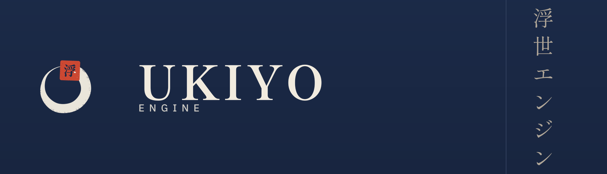
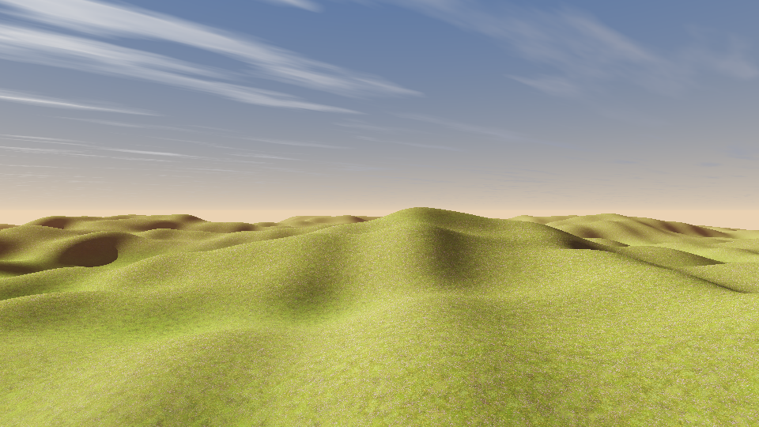
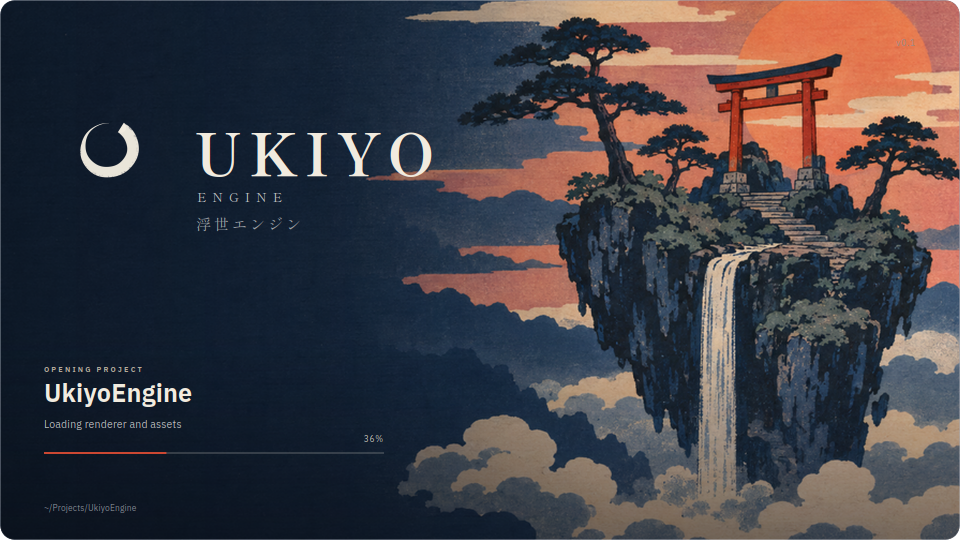

# Ukiyo Engine 浮世エンジン



A C++17 game engine and world editor built around an anime-leaning renderer: cel shading with depth-aware outlines, a
layered terrain with procedural grass, virtual geometry for static meshes, an animation stack with humanoid retargeting
and motion matching, Jolt physics, Lua scripting, Recast navigation, networking, an Input System in the Unity idiom, and
a launcher for projects.

The interface is English by default. The typeface carries Japanese, and so does the name: 浮世 (*ukiyo*, "the floating
world") is the register the renderer is aimed at.

The identity is an ensō that does not close, and a vermilion hanko carrying 浮 stamped into the place where the brush
stopped. It is drawn by `tools/brand.py` from vector maths, so the repository holds the source and not only the raster —
see [Brand and design](#brand-and-design).

## The workspace

Five programs and two libraries, all from one build:

| Target | What it is |
| --- | --- |
| `ukiyo_hub` | the launcher — recent projects, templates, the new-project dialog |
| `ukiyo_editor` | the editor — viewport, hierarchy, inspector, terrain brushes, animation, shader graph, play mode |
| `ukiyo` | the standalone model viewer, used for regression shots and GPU tests |
| `ukiyo_core` / `ukiyo_systems` | the engine libraries both applications link |

Plus the offline tools, which are part of the build rather than a separate script directory: `terrain_preview`,
`vgeom_preview`, `pathtrace_preview`, `motion_demo`, `ukiyo_pak`, `ukiyo_shader_tool`.

## Screenshots

| | |
| --- | --- |
|  |  |
| The Terrain Lab tile with the vendored ground textures and grass, rendered offline by `terrain_preview` ([docs/TERRAIN.md](docs/TERRAIN.md)). | The same 131 072-triangle tile built into a virtual-geometry cluster tree, cut at 1 px and 8 px ([docs/VGEOM.md](docs/VGEOM.md)). |
|  |  |
| The scene through a CPU path tracer — one cosine bounce, ray-marched sun shadows, the engine's own layer weights and textures. The ground truth the real-time renderer is measured against, on any machine ([docs/PATHTRACE.md](docs/PATHTRACE.md)). | The same scene through the **real-time estimator** that runs in the renderer: one traced bounce at half resolution, accumulated over sixteen frames and composited at full resolution. RMSE 0.035 against a 64-sample tracer, explaining 43 % of the error the raster leaves ([docs/PATHTRACE.md](docs/PATHTRACE.md)). |
|  |  |
| Ten seconds of motion matching: the route, the footprints and four poses from the run. Walk, run and idle are chosen by the matcher from a database of 490 000 poses ([docs/MOTION.md](docs/MOTION.md)). | The launcher's splash, painted in C++ by the program itself — the woodblock artwork, the lockup in the open sky, and the determinate bar. |

The hub is the first thing anyone sees, so it is checked like a screen and not like a build artifact: CI captures its
three pages offscreen with `ukiyo_hub --screenshots renders` and commits them to `docs/hub/`. The images below are the
program at the commit you are reading, not a mockup.

| | |
| --- | --- |
|  |  |
| The Projects page: what you had open, a search, and the empty state that leads to a template. | The Templates page: the three starters the engine ships, with what each one gives you. |


*The About page. The rail carries the hanko at 26 px — the ensō's gap closes up at that size and reads as a letter C,
so the small sizes use the stamp — with the wordmark and 浮世エンジン set in the display face beside it.*

## Quick start

### Dependencies

* CMake 3.20+, a C++17 compiler
* Vulkan loader and headers, and the X11 headers GLFW's backend needs
* glslang (the engine compiles generated material shaders to SPIR-V at runtime)
* Qt 6 base + tools for the hub and the editor

GLM, nlohmann/json, GLFW, Jolt, meshoptimizer, Lua, miniaudio, Recast, cgltf, stb, nodeeditor, glad and VkMemAlloc are
**vendored** under `third_party/` — nothing is fetched at configure time, and [third_party/VENDOR.md](third_party/VENDOR.md)
records each version, licence and why it is (or is not) in the tree. On Debian/Ubuntu the system packages are:

```sh
sudo apt-get install -y cmake g++ libvulkan-dev glslang-tools glslang-dev \
    qt6-base-dev qt6-base-dev-tools libqt6opengl6-dev qt6-tools-dev qt6-tools-dev-tools \
    libx11-dev libxrandr-dev libxinerama-dev libxcursor-dev libxi-dev libxext-dev
```

### Build and run

```sh
cmake -B build -DCMAKE_BUILD_TYPE=Release
cmake --build build --parallel 4
./build/ukiyo_hub            # launcher
./build/ukiyo_editor         # editor, opens the checkout as its project
./build/ukiyo model.glb      # model viewer
```

Shaders are compiled from `shaders/` into `build/shaders/` by `tools/shaderc.py` as part of the build. There is a
Vulkan backend and an OpenGL backend; `--backend gl` selects the latter.

## What is in the engine

### Rendering

* **Two RHI backends** — Vulkan and OpenGL behind `src/rhi/rhi.h`, with the same pipelines, descriptor sets and render
  passes. A pass is written once.
* **Cel shading** — a two-band toon ramp with a soft terminator, rim light, depth-aware outlines and a scene-tuned
  grade. `Custom Anime` tonemap, bloom, vignette, FXAA/SSAA/TAA and LUT grading, all authored in `shaders/`.
* **Terrain** — heightmap tiles with up to eight layers blended by height, slope and paint; a layer atlas; slope-aware
  triplanar mapping; normal, AO and detail overlays; brush editing; far-field culling. See [docs/TERRAIN.md](docs/TERRAIN.md).
* **Grass** — jittered scatter per ground cell with detail-map thinning, three distance bands, per-blade bezier wind and
  widening, and a chunked indirect-friendly draw. See [docs/GRASS.md](docs/GRASS.md).
* **Virtual geometry** — static meshes are clustered into a 128-triangle hierarchy with per-cluster error and drawn
  through a screen-space cut, cached beside the model. See [docs/VGEOM.md](docs/VGEOM.md).
* **Shadows** — three cascades into a 3 × 2048² atlas, slope-scaled bias, PCF.
* **Traced bounce light** — one diffuse bounce traced against the terrain heightfield at half resolution, accumulated
  over sixteen frames and composited at full resolution. A fragment shader with no ray-tracing or compute feature, so it
  runs on any integrated GPU; measured against the CPU path tracer at 0.035 RMSE, adding four fifths of the light the
  raster leaves out. See [docs/PATHTRACE.md](docs/PATHTRACE.md).
* **Path-traced reference** — `tools/pathtrace_preview` renders the terrain on the CPU with true bounces and exact sun
  shadows, at whatever sample count the machine can afford. No RT cores, no DLSS, no GPU at all: it is the ground truth
  the real-time renderer is judged against, and it produces the same image on a laptop and a workstation.
* **Water, particles, foliage, face SDF, PMX models**, and a shader graph whose node editor generates GLSL and compiles
  it to SPIR-V at runtime.

### Animation

* glTF/VRM loading, humanoid retargeting, crossfades, an idle state machine, clip editing (`.ukanim`).
* **Motion matching** — BVH motion capture into a 33-dimensional feature database (trajectory, feet and a pose
  descriptor), a KD-tree over the 17 dimensions that separate one gait from another, a full-skeleton pose cost, and
  inertialized playback, plus a controller that turns stick input into a world-space pose. All 77 LAFAN1 captures —
  490 000 poses — build in 0.7 s and match in 0.37 ms. The reader trims the T-pose calibration hold and takes the
  character's forward from the toes, both of which the corpus proved necessary. See [docs/MOTION.md](docs/MOTION.md).
* Two-bone and FABRIK arm IK, hand-on-waist constraints, spring bones, hit reactions and sway.

### Systems

* **Jolt** rigid bodies and character controllers, colliders written by the editor.
* **Recast/Detour** navigation and pathfinding.
* **Lua** scripting with a bound world API; prefabs, scenes and materials are JSON.
* **Input** as action maps with Unity's `.inputactions` assets: keyboard, mouse and gamepads, 1D and 2D composites,
  press/hold/tap interactions, processors, control schemes and rebinding. The parser and runtime are tested in CI
  against the semantics of the Unity Input System, not a simplified subset. See [docs/INPUT.md](docs/INPUT.md).
* **Audio** through miniaudio; **networking** over UDP with snapshots and interpolation.
* **Virtual file system** with a pak format (`tools/ukiyo_pak.cpp`), so a shipped project is one folder.

## The editor

The editor is a Qt Widgets application with a custom viewport. It has a hierarchy, inspector, asset browser, terrain
paint/sculpt tools with a brush preview, a material inspector with live thumbnails, a shader graph editor, an animation
timeline and blend panel, gizmos, prefab mode, play mode, a benchmark scene and a project-settings dialog (Quality,
Graphics, Lighting). Projects are made by the hub from templates and opened directly.

## Brand and design


### The mark

The ensō (円相) is drawn as a *brush field* rather than as polygons: every pixel is evaluated in (t, u) — position along
the stroke and offset across it — so width, the ragged loaded edge, the round landing and the dry tail that splits into
three strands are properties of the brush. The ring does not close, and the hanko sits **in** the gap: the place the
brush stopped is where the name is stamped.

At 32 px and below the character inside the seal turns to mud, so the small sizes are the bare block of pigment —
`ukiyo-mark-32.png` and `ukiyo-seal-32.png`. At 26 px, which is what the hub's rail draws, the block still reads as a
stamp and is the one red accent in an otherwise indigo interface.

### Type

Two faces, and neither of them is a fallback:

* **Shippori Mincho** — the display face. A Japanese Mincho whose Latin is cut with the same brush-derived contrast as
  the kana, so `UKIYO` and 浮世エンジン are visibly the same hand. Subset to the identity's own words and kana
  (206 KB per weight) and registered at startup by `editor::loadDisplayFont`.
* **IBM Plex Sans JP** — the interface face. One family covers Latin and Japanese, so a menu, a file path and a
  Japanese label sit in the same voice. Registered by `editor::loadBrandFont`.

A menu should not look like a logo: the display face is for the mark, the splash and the brand moments, and Plex is for
the work. Both are SIL OFL; their licences sit beside them in `editor/res/fonts/`.

### Palette

| | | |
| --- | --- | --- |
| `#F1EBDF` | ink | the paper of a print |
| `#CC4832` | vermilion | 朱 — the seal, and the only accent |
| `#1A2844` | indigo | 藍 — the night ground |
| `#B0A698` | muted | the second line of a lockup |

### The splash

Two beats, both painted by `splash_screen.cpp`:

1. **The mark**, alone on the indigo ground, settling a hair in scale as it fades up.
2. **The artwork**, with the lockup in the open sky at the left and the status block beneath it in the same column. A
   horizontal wash runs from the margin to two thirds across — dense enough to seat the type, gone before it reaches the
   island — and a foot gradient carries the bar.

Everything is laid out on a 960 × 540 grid and multiplied by `s`, so the screen keeps its proportions on any display.
`ukiyo_hub --splash-shots renders` paints both beats offscreen, which is how the images above exist without a display.


*Beat one, captured by the same command: the mark alone, settling on the indigo ground.*

Regenerate the identity with:

```sh
python3 tools/brand.py .     # needs pillow + numpy
```

This writes the mark at 512/256/128/64/32 px, the seal, the horizontal lockup, the stacked splash mark and the README
plate into `editor/res/brand/` and `docs/brand/`.

## Textures

`editor/res/terrain/` carries the reference project's ground set — `Grass_Moss`, `Heather` and `Muddy`, each as albedo,
normal and AO, converted from TIFF and from HDRP's mask map. That is **9 of the 9 ground maps** the terrain shader can
read, plus `plant_detail` for the grass scatter. The other 30 files in the reference's `Textures/Details/` are billboard
plant cards (bush, fern, dry grass), which this engine does not draw: its grass is procedural geometry. `NOTICE.md`
beside the textures records the file-by-file mapping, and `tools/verify_terrain_textures.py` checks the claim in CI —
every layer present, the right size, three genuinely different images, and normal maps that are actually tangent-space.

## Repository layout

```
assets/            sample models, animation library, LUTs, shaders
docs/              the long-form docs, screenshots and the brand sheets
editor/            hub + editor (Qt), resources, fonts, brand marks
src/app/           the standalone viewer
src/engine/        renderer, terrain, grass, vgeom, model, animation, motion matching, …
src/input/         the Input System: assets, runtime, GLFW backend
src/rhi/           Vulkan and OpenGL backends
src/systems/       physics, audio, network, navigation, scripting, vfx, world
tests/             CPU tests and GPU regression programs
tools/             shader compiler, pak tool, offline previews, brand builder, asset checks
third_party/       Jolt, meshoptimizer, Lua, miniaudio, Recast, cgltf, stb, nodeeditor, …
```

About 59 000 lines of C++ and 56 shaders.

## Tests and CI

Every push installs the dependencies, builds every target, and then runs:

```sh
./build/systems_test       # physics, Lua, world, navigation, water, LOD, terrain, grass, foliage
./build/network_test
./build/project_test
./build/vgeom_test
./build/motion_test
./build/input_test
./build/gi_test            # the estimator's numbers against the tracer
python3 tools/verify_terrain_textures.py --repo .
python3 tools/shader_bindings.py shaders
UKIYO_RT_MAX_RMSE=0.05 ./build/pathtrace_preview realtime renders/gi-realtime.png . 480 270 8 4 32
./build/motion_demo renders/motion-demo.png
QT_QPA_PLATFORM=offscreen ./build/ukiyo_hub --selftest
QT_QPA_PLATFORM=offscreen ./build/ukiyo_hub --screenshots renders
QT_QPA_PLATFORM=offscreen ./build/ukiyo_hub --splash-shots renders
```

The renders are committed to `docs/` and uploaded as an artifact, so a graphics change can be looked at without a local
GPU — the screenshots in this README are that pipeline's output. `tests/` also carries GPU regression programs
(`lod_gpu_test`, `endfield_gpu_test`, `particles_gpu_test`, `water_render`) that run where there is a device.

## Documentation

| Doc | What it covers |
| --- | --- |
| [docs/TERRAIN.md](docs/TERRAIN.md) | heightmap tiles, layers, atlas, brushes, culling |
| [docs/GRASS.md](docs/GRASS.md) | the MagicGrass adaptation: scatter, bands, wind, RHI limits |
| [docs/VGEOM.md](docs/VGEOM.md) | the cluster hierarchy, the cut, the cache, measured costs |
| [docs/MOTION.md](docs/MOTION.md) | the feature vector, the KD-tree, the controller, the retarget |
| [docs/PATHTRACE.md](docs/PATHTRACE.md) | the CPU reference tracer, the traced-bounce estimator, and the iGPU argument |
| [docs/INPUT.md](docs/INPUT.md) | action maps, the `.inputactions` format, the Unity semantics kept, the CI test |

## Credits

* Virtual geometry follows [Jacinth-19/nanite-at-home](https://github.com/Jacinth-19/nanite-at-home); motion matching
  follows [Jacinth-19/MotionMatchingInUnity](https://github.com/Jacinth-19/MotionMatchingInUnity), which uses the
  [LAFAN1](https://github.com/ubisoft/ubisoft-laforge-animation-dataset) dataset. In both cases the reference supplied
  the assets and the pipeline, and the implementation here is the engine's own — in C++, against this RHI.
* Grass scatter and the ground texture set follow
  [Jacinth-19/UnityGrassIndirectRenderingExample](https://github.com/Jacinth-19/UnityGrassIndirectRenderingExample).
  The terrain textures are the reference's `Grass_Moss`, `Heather` and `Muddy` sets, converted from TIFF to PNG and from
  HDRP's mask map to an AO map; `NOTICE.md` records the mapping, and the coverage is checked in CI.
* The path tracing reference is [ColinLeung-NiloCat/NiloPathTracing](https://github.com/ColinLeung-NiloCat/NiloPathTracing),
  which needs an RTX card, DXR and DLSS Ray Reconstruction. Nothing of it can run on an iGPU, which is the point of
  [docs/PATHTRACE.md](docs/PATHTRACE.md): the estimator reaches the same bounce in a fragment shader instead.
* Animation library: Quaternion Universal Animation Library (CC0). Sample characters: Alicia Solid and Seed-san (VRM).
  Physics: Jolt. Mesh simplification: meshoptimizer. Icons: Material Symbols (Apache 2.0). Type: Shippori Mincho and IBM
  Plex Sans JP (SIL OFL).

## Status

The engine builds and tests on Linux CI, and the editor and hub run on Windows, Linux and macOS. Known gaps are listed
at the end of each doc — the largest are GPU-driven virtual geometry (no compute or multi-draw in the RHI yet), contact
occlusion in the traced bounce light (its rays start 5 cm off the surface), and foot locking in motion matching.
