# Ukiyo Engine 浮世エンジン


A C++17 game engine and world editor built around an anime-leaning renderer: cel shading with depth-aware outlines, a
layered terrain with procedural grass, virtual geometry for static meshes, an animation stack with humanoid retargeting
and motion matching, Jolt physics, Lua scripting, Recast navigation, networking, an Input System in the Unity idiom, and
a launcher for projects.

The interface is English by default. The typeface carries Japanese, and so does the name: 浮世 (*ukiyo*, "the floating
world") is the register the renderer is aimed at.

The identity is an ensō that does not close, and a vermilion hanko carrying 浮 stamped into the place where the brush
stopped. It is drawn by `tools/brand.py` from vector maths, so the repository holds the source and not only the raster —
see [Brand and design](#brand-and-design).

## The workspace

Three programs, two libraries and a set of offline tools, all from one build:

| Target | What it is |
| --- | --- |
| `ukiyo_hub` | the launcher — recent projects, templates, the new-project dialog |
| `ukiyo_editor` | the editor — viewport, hierarchy, inspector, terrain brushes, animation, shader graph, play mode |
| `ukiyo_player` | the player — boots a built project and runs it |
| `ukiyo` | the standalone model viewer, used for regression shots and GPU tests |
| `ukiyo_core` / `ukiyo_systems` | the engine libraries both applications link |

Plus the offline tools, which are part of the build rather than a separate script directory: `terrain_preview`,
`vgeom_preview`, `pathtrace_preview`, `motion_demo`, `ukiyo_pak`, `ukiyo_shader_tool`, `ukiyo_pack` (packages a game),
`lantern_assets` (generates the first game's geometry).

## Screenshots

| | |
| --- | --- |
|  |  |
| The Terrain Lab tile with the vendored ground textures and grass, rendered offline by `terrain_preview` ([docs/TERRAIN.md](docs/TERRAIN.md)). | The scene through a CPU path tracer — one cosine bounce, ray-marched sun shadows, the engine's own layer weights and textures, and the ground truth the real-time renderer is measured against ([docs/PATHTRACE.md](docs/PATHTRACE.md)). |
|  | 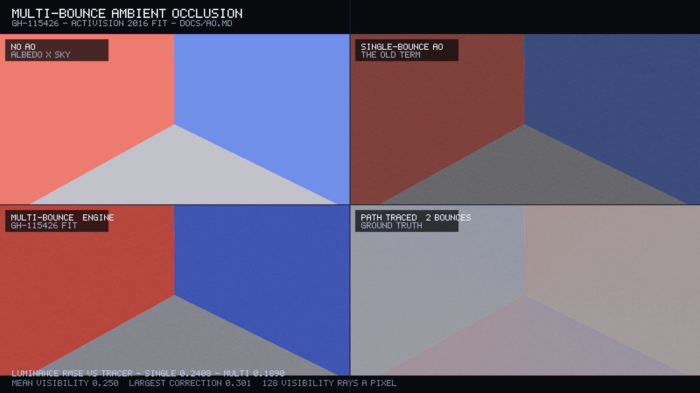 |
| The same scene through the **real-time estimator** that runs in the renderer: one traced bounce at half resolution, accumulated over sixteen frames and composited at full resolution. RMSE 0.035 against a 64-sample tracer, explaining 43 % of the error the raster leaves ([docs/PATHTRACE.md](docs/PATHTRACE.md)). | Multi-bounce ambient occlusion: a corner of three planes under single-bounce AO (top right) and the albedo-weighted fit this engine now applies (bottom left), against a two-bounce tracer (bottom right). Luminance error falls from 0.241 to 0.189 ([docs/AO.md](docs/AO.md)). |
| 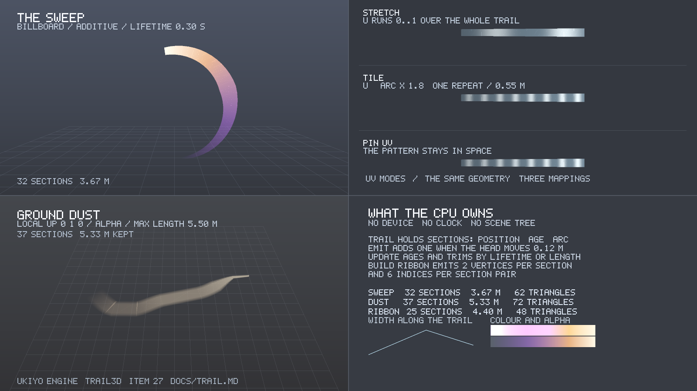 |  |
| Trail ribbons built by the engine's CPU code and shaded by a software rasteriser, so the figure needs no GPU: an additive sword sweep, the three UV mappings, and a ground ribbon that does not billboard ([docs/TRAIL.md](docs/TRAIL.md)). | Ten seconds of motion matching: the route, the footprints and four poses from the run. Walk, run and idle are chosen by the matcher from a database of 490 000 poses ([docs/MOTION.md](docs/MOTION.md)). |
| 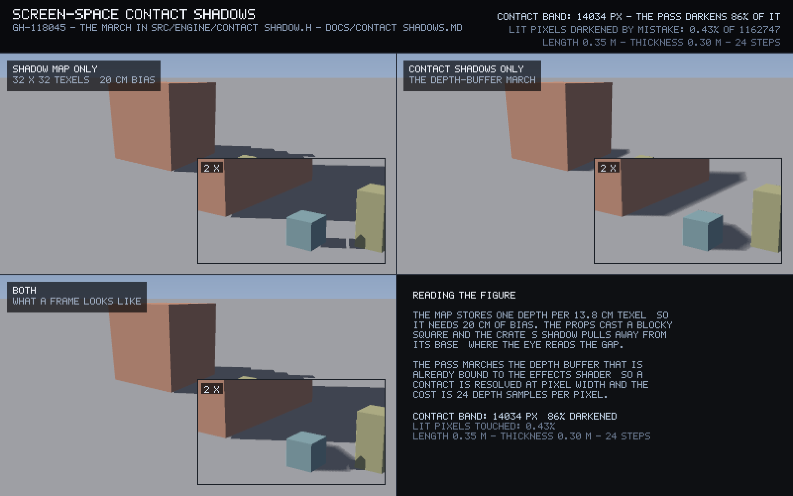 |  |
| Screen-space contact shadows (GH-118045): a 32 × 32 shadow map with 20 cm of bias (top left), the depth-buffer march alone (top right) and both (bottom left), each with a 2× crop of the same contact. The pass darkens 86 % of the contact band and touches 0.43 % of the lit pixels ([docs/CONTACT_SHADOWS.md](docs/CONTACT_SHADOWS.md)). | The launcher's splash, painted in C++ by the program itself — the woodblock artwork, the lockup in the open sky, and the determinate bar. |
| 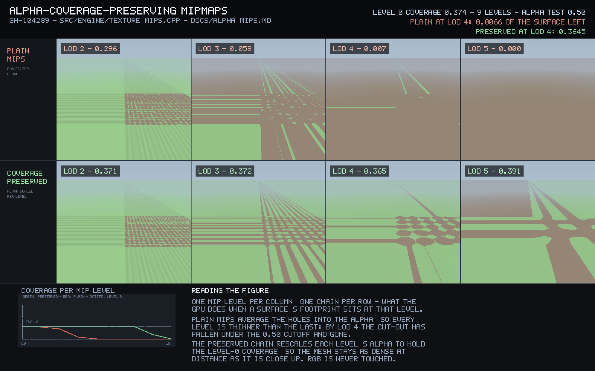 |  |
| Alpha-coverage-preserving mipmaps (GH-104289): one fixed mip level per column, the plain box filter on the top row and the preserved chain below it. Coverage holds at 0.37 instead of collapsing to 0.007, so the cut-out does not dissolve ([docs/ALPHA_MIPS.md](docs/ALPHA_MIPS.md)). | The 131 072-triangle Terrain Lab tile built into a virtual-geometry cluster tree, cut at 1 px and 8 px ([docs/VGEOM.md](docs/VGEOM.md)). |
|  | 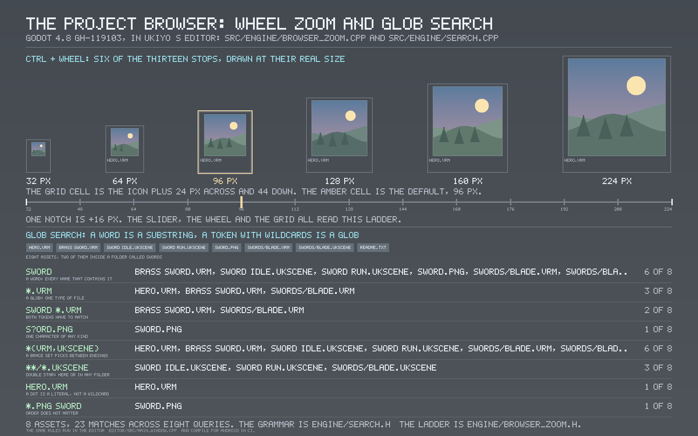 |
| Grass scatter over the terrain, drawn by `grass_scatter_preview` from the same bands the engine uses ([docs/GRASS.md](docs/GRASS.md)). | The Project browser's two new gestures (GH-119103): six of the thirteen thumbnail stops drawn at their real pixel size, and eight glob queries run through the engine's matcher against the asset list above them — 23 matches, computed by `browser_qol_preview` ([docs/FILESYSTEM.md](docs/FILESYSTEM.md)). |
| 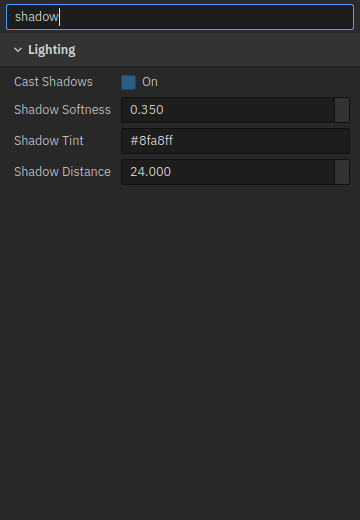 | 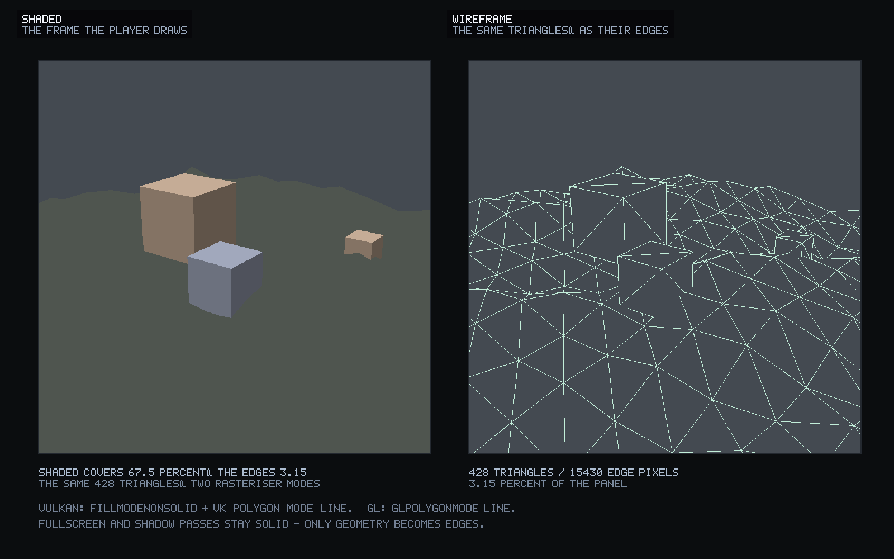 |
| The Inspector's search (Flax 1.13): a query typed into the box narrows four foldouts to the rows it matches, opens the section with the hit, and puts everything back when it is cleared — drawn by the editor itself ([docs/INSPECTOR_SEARCH.md](docs/INSPECTOR_SEARCH.md)). | The wireframe view (Flax 1.13): one scene of 428 triangles, shaded and drawn as its edges, hidden lines removed by the same depth buffer. 67.5 % of the panel filled, 3.15 % as edges ([docs/WIREFRAME.md](docs/WIREFRAME.md)). |
| 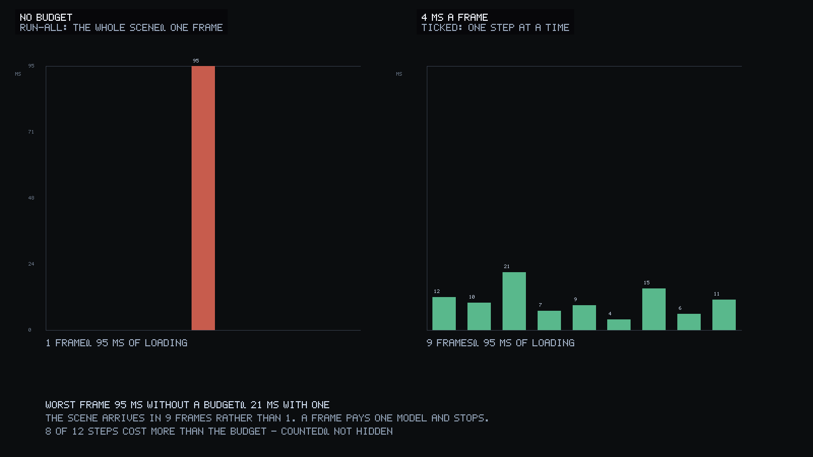 | 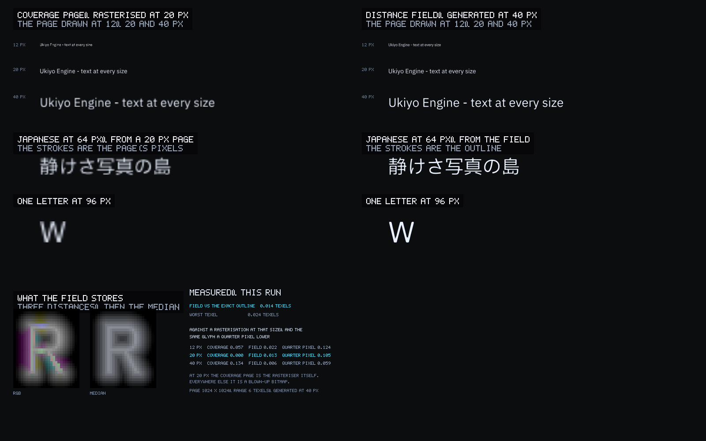 |
| Loading with a frame budget (Flax 1.11): 95 ms of scene loading in one frame without a budget, and spread over nine frames with one, worst 21 ms. The bars are the shipping scheduler's own decisions ([docs/ASYNC_LOADING.md](docs/ASYNC_LOADING.md)). | Multi-channel distance fields (Flax 1.12): the same layout from a page rasterised at one size (left) and from a field (right), drawn at 12, 20, 40 and 96 px. The field is 0.014 texels from the exact outline ([docs/MSDF.md](docs/MSDF.md)). |
| 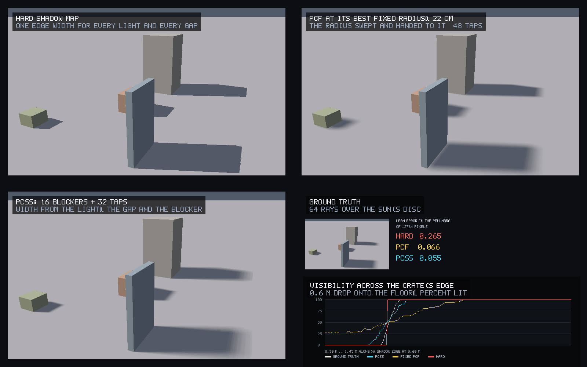 | |
| Percentage-closer soft shadows (Flax 1.13): one shadow map filtered three ways, against 64 rays over the sun's disc. Mean error in the penumbra: 0.266 hard, 0.066 for the fixed filter at its swept best radius, 0.055 for PCSS ([docs/PCSS.md](docs/PCSS.md)). | |
| Multi-channel distance fields (Flax 1.12): the same layout from a page rasterised at one size (left) and from a field (right), drawn at 12, 20, 40 and 96 px, with the field's three channels beside the measurements. The field is 0.014 texels from the exact outline and 0.022 from a rasterisation at 12 px; the coverage page is 0.134 of full coverage wrong when drawn at twice its size ([docs/MSDF.md](docs/MSDF.md)). | Percentage-closer soft shadows (Flax 1.13): one shadow map filtered three ways, against 64 rays over the sun's disc. Mean error in the penumbra: 0.266 hard, 0.066 for the fixed filter at its swept best radius, 0.055 for PCSS ([docs/PCSS.md](docs/PCSS.md)). |
| Percentage-closer soft shadows (Flax 1.13): one shadow map filtered three ways — the map's own single tap, a fixed-radius PCF swept and handed its best radius, and PCSS — each measured against 64 rays over the sun's disc, with the visibility along a floor line crossing the crate's shadow edge at the bottom right. Mean error in the penumbra: 0.266 hard, 0.066 for the tuned fixed filter, 0.055 for PCSS ([docs/PCSS.md](docs/PCSS.md)). | |

The hub is the first thing anyone sees, so it is checked like a screen and not like a build artifact: CI captures its
three pages offscreen with `ukiyo_hub --screenshots renders` and commits them to `docs/hub/`. The images below are the
program at the commit you are reading, not a mockup.

| | |
| --- | --- |
|  |  |
| The Projects page: what you had open, a search, and the empty state that leads to a template. | The Templates page: the three starters the engine ships, with what each one gives you. |


*The About page. The rail carries the hanko at 26 px — the ensō's gap closes up at that size and reads as a letter C,
so the small sizes use the stamp — with the wordmark and 浮世エンジン set in the display face beside it.*

## Quick start

### Dependencies

* CMake 3.20+, a C++17 compiler
* Vulkan loader and headers, and the X11 headers GLFW's backend needs
* glslang (the engine compiles generated material shaders to SPIR-V at runtime)
* Qt 6 base + tools for the hub and the editor

GLM, nlohmann/json, GLFW, Jolt, meshoptimizer, Lua, miniaudio, Recast, cgltf, stb, nodeeditor, glad and VkMemAlloc are
**vendored** under `third_party/` — nothing is fetched at configure time, and [third_party/VENDOR.md](third_party/VENDOR.md)
records each version, licence and why it is (or is not) in the tree. On Debian/Ubuntu the system packages are:

```sh
sudo apt-get install -y cmake g++ libvulkan-dev glslang-tools glslang-dev \
    qt6-base-dev qt6-base-dev-tools libqt6opengl6-dev qt6-tools-dev qt6-tools-dev-tools \
    libx11-dev libxrandr-dev libxinerama-dev libxcursor-dev libxi-dev libxext-dev
```

### Build and run

```sh
cmake -B build -DCMAKE_BUILD_TYPE=Release
cmake --build build --parallel 4
./build/ukiyo_hub            # launcher
./build/ukiyo_editor         # editor, opens the checkout as its project
./build/ukiyo model.glb      # model viewer
```

Shaders are compiled from `shaders/` into `build/shaders/` by `tools/shaderc.py` as part of the build. There is a
Vulkan backend and an OpenGL backend; `--backend gl` selects the latter.

### The games

`games/afterglow` is the shipped game: a dusk village of extinguished lanterns to relight — proximity-driven so it
plays the same on a thumb, with save slots, a generated soundtrack, EN/JA localisation and named lights the script
brings back one at a time. `games/lantern-run` is the smaller first game it was built on: a courtyard, five lanterns
to gather, one script, four GLBs from `tools/lantern_assets.cpp`.

```
./build/ukiyo_player --project games/afterglow --build Build/build.json
```

Whichever platform you built for, the same project can be packaged for someone else:

```
./build/ukiyo_pack --project games/afterglow --player build/ukiyo_player \
  --platform linux --shaders build/shaders --out dist/afterglow-linux --zip dist/afterglow-linux.zip
```

CI does exactly that on Linux and Windows for **both** games, runs Afterglow's package on a software Vulkan device and
publishes its frame to `docs/afterglow.png`, and uploads `afterglow-linux`, `afterglow-windows` alongside Lantern Run's
zips — see [docs/GAME.md](docs/GAME.md) and [docs/PACKAGING.md](docs/PACKAGING.md). The `android` job builds
`afterglow-android`: a signed, installable APK with the player for arm64 and x86_64, both games staged in its assets,
booting Afterglow, and no Java at all; [docs/ANDROID.md](docs/ANDROID.md) has the layout, the tools and what is still
missing there.

## What is in the engine

### Rendering

* **Two RHI backends** — Vulkan and OpenGL behind `src/rhi/rhi.h`, with the same pipelines, descriptor sets and render
  passes. A pass is written once.
* **Cel shading** — a two-band toon ramp with a soft terminator, rim light, depth-aware outlines and a scene-tuned
  grade. `Custom Anime` tonemap, bloom, vignette, FXAA/SSAA/TAA and LUT grading, all authored in `shaders/`.
* **Terrain** — heightmap tiles with up to eight layers blended by height, slope and paint; a layer atlas; slope-aware
  triplanar mapping; normal, AO and detail overlays; brush editing; far-field culling. See [docs/TERRAIN.md](docs/TERRAIN.md).
* **Grass** — jittered scatter per ground cell with detail-map thinning, three distance bands, per-blade bezier wind and
  widening, and a chunked indirect-friendly draw. See [docs/GRASS.md](docs/GRASS.md).
* **Virtual geometry** — static meshes are clustered into a 128-triangle hierarchy with per-cluster error and drawn
  through a screen-space cut — selected by a compute shader when it is built, with the CPU walk kept as the fallback
  — cached beside the model. See [docs/VGEOM.md](docs/VGEOM.md).
* **Shadows** — three cascades into a 3 × 2048² atlas, slope-scaled bias, PCF.
* **Traced bounce light** — one diffuse bounce traced against the terrain heightfield at half resolution, accumulated
  over sixteen frames, denoised by two à-trous passes and composited at full resolution. A fragment shader with no
  ray-tracing or compute feature, so it runs on any integrated GPU; measured against the CPU path tracer at 0.035
  RMSE, adding four fifths of the light the raster leaves out. The denoiser is the iGPU counterpart of the reference's
  DLSS Ray Reconstruction: one ray per pixel per frame with it is closer to converged (0.75/255) than eight rays
  without it (1.42/255). See [docs/PATHTRACE.md](docs/PATHTRACE.md).
* **Path-traced reference** — `tools/pathtrace_preview` renders the terrain on the CPU with true bounces and exact sun
  shadows, at whatever sample count the machine can afford. No RT cores, no DLSS, no GPU at all: it is the ground truth
  the real-time renderer is judged against, and it produces the same image on a laptop and a workstation.
* **Water, particles, foliage, face SDF, PMX models**, and a shader graph whose node editor generates GLSL and compiles
  it to SPIR-V at runtime.

### Animation

* glTF/VRM loading, humanoid retargeting, crossfades, an idle state machine, clip editing (`.ukanim`).
* **Motion matching** — BVH motion capture into a 33-dimensional feature database (trajectory, feet and a pose
  descriptor), a KD-tree over the 17 dimensions that separate one gait from another, a full-skeleton pose cost, and
  inertialized playback, plus a controller that turns stick input into a world-space pose. All 77 LAFAN1 captures —
  490 000 poses — build in 0.7 s and match in 0.37 ms. The reader trims the T-pose calibration hold and takes the
  character's forward from the toes, both of which the corpus proved necessary. **Foot locking** pins the contact foot
  with a two-bone solve, cutting a 0.6 m/s stride mismatch from 21 mm to 1 mm of slide per frame. See
  [docs/MOTION.md](docs/MOTION.md).
* **Multi-bounce ambient occlusion** (Godot 4.8's GH-115426): the AO term is a cubic in the occlusion whose
  coefficients come from the surface albedo, so a corner of a coloured room keeps its colour and its light instead of
  going grey and black. The albedo rides in the normal pre-pass's second target; the fit is applied in the screen-space
  pass, clamped so a post-processed frame can only have light restored, never added
  ([docs/AO.md](docs/AO.md), 21 % closer to a two-bounce tracer in the figure).
* **Alpha-coverage-preserving mipmaps** (Godot 4.8's GH-104289): an alpha-tested cut-out keeps the fraction of its
  surface that passes the cutoff on every mip level, instead of losing it to the average — the reason a fence dissolves
  at distance. The loader builds the chain on the CPU, where a coverage search can run, and both backends upload it
  as-is. The figure's plane holds 0.37 coverage to LOD 5 where the plain chain is at 0.007
  ([docs/ALPHA_MIPS.md](docs/ALPHA_MIPS.md)).
* **Screen-space contact shadows** (Godot 4.8's GH-118045): the short shadows a cascaded shadow map cannot resolve,
  marched in the depth buffer that the screen-space pass already holds — 0.35 m towards the sun in 24 steps, with a
  growing bias and a thickness that keeps the result at contact scale instead of turning into a second shadow map. No per-
  light target, no dispatch, no blur: one loop in `effects.frag`, on the pixels whose normal faces the sun. The figure's
  frame darkens 86 % of its contact band and touches 0.43 % of the lit pixels ([docs/CONTACT_SHADOWS.md](docs/CONTACT_SHADOWS.md)).
* **An Inspector that can be searched** (Flax 1.13's Properties panel search): a filter box above the Inspector, speaking
  the Project browser's own grammar — every word must match, a word can be a glob, a word can be a value, `-word` removes
  what it matches — over row labels, section names and the values themselves. A section survives only when one of its
  rows does, and opens so the hit is visible. The rule is engine code with 46 checks behind it; the live panel and the
  figure are the same widget walk ([docs/INSPECTOR_SEARCH.md](docs/INSPECTOR_SEARCH.md)).
* **A wireframe view** (Flax 1.13): `View > Wireframe` draws the geometry passes as the edges of the triangles actually
  submitted, leaving every fullscreen pass and the shadow map solid. One flag on the RHI's pipeline description, backed by
  `fillModeNonSolid` on Vulkan and `glPolygonMode` on GL, and a device test that checks every lit pixel lies on the
  geometry's own edge ([docs/WIREFRAME.md](docs/WIREFRAME.md)).
* **Loading with a frame budget** (Flax 1.11's async scene loading): a scene's models are queued as steps and a frame
  runs only as many as its budget pays for — a step runs whole or not at all, so no half-built model is ever drawn, and a
  step that costs more than the whole budget is counted rather than hidden. 95 ms of loading becomes nine frames of
  nothing worse than 21 ms ([docs/ASYNC_LOADING.md](docs/ASYNC_LOADING.md)).
* **Multi-channel signed distance fields for text** (Flax 1.12's MSDF fonts): one glyph page generated at 40 px and
  sharp at every size, because it stores the distance to the outline rather than the outline's pixels. Three channels,
  and the renderer takes their median, which is what keeps a corner a corner instead of rounding it. The field tracks
  the exact outline to 0.014 texels and lands within 0.022 of a rasterisation at 12 px — three to twenty times closer
  than that rasteriser is to itself a quarter pixel away — where the coverage page it replaces is 0.134 wrong when
  drawn at twice its size. Its alpha ramp is one screen pixel wide rather than the textbook two, which is what stops
  13 px text rendering bold ([docs/MSDF.md](docs/MSDF.md)).
* **Percentage-closer soft shadows** (Flax 1.13's PCSS): the shadow edge's width comes from the light, not from a
  constant — a blocker search reads the shadow map's average occluder distance, and the penumbra is `2 tanRadius × gap`
  wide. Contact hardens for free, a plank and a wall in the same shadow map get different edges, and a fixed-radius
  filter cannot do either: at equal cost, PCSS is 16 % closer to a 64-ray ground truth than the fixed filter at its
  *swept best* radius, and 2.9× closer across three gaps that must share one filter. In `src/engine/pcss.h` and
  `shaders/shadow_sample.glsl`, 16 + 32 taps ([docs/PCSS.md](docs/PCSS.md)).
* **Trails** in Godot 4.8's `Trail3D` shape: a ribbon of quads accumulated as an object moves, limited by lifetime or
  path length, shaped by a width curve and a colour gradient, billboarded or pinned to a ground plane, with stretch,
  tiling and pinned UVs. The geometry is plain CPU code (`src/engine/trail.cpp`) so the test measures it without a GPU;
  the renderer uploads it as one indexed draw per blend mode. See [docs/TRAIL.md](docs/TRAIL.md).
* Two-bone and FABRIK arm IK, hand-on-waist constraints, spring bones, hit reactions and sway.

### Systems

* **Jolt** rigid bodies and character controllers, colliders written by the editor.
* **Recast/Detour** navigation and pathfinding.
* **Lua** scripting: Lua 5.4 in a sandbox, one state per object, so every object in a level runs its own script with its
  own globals. Five hooks (`onStart`, `onUpdate`, `onContact`, `onSceneLoaded`, `onDestroy`), a 23-function `ukiyo`
  table for position, physics, sound, particles, raycasts, animation parameters, local players and scene loads, and a
  `require()` that reads `Scripts/` and `assets/` with a per-world cache. Errors name the file and line and carry a
  traceback; the level keeps running. Saving a script from the built-in editor **or an external IDE** reloads the
  running level without stopping play. The editor ships a Lua window (highlighting, line numbers, Check, error line) and
  writes the project the files every Lua tool wants — a LuaCATS stub of the whole API, `.luarc.json`, `.editorconfig`,
  `stylua.toml`, `selene.toml` and VS Code's extension list and settings — so completion, formatting, linting and
  debugging work in VS Code, Neovim or Zed with no setup of their own. **Tools > Scripting Tools** shows that list,
  says which programs this machine already has, installs an extension with one click and sets the external editor from
  the editors it finds. See [docs/LUA.md](docs/LUA.md).
* **Input** as action maps with Unity's `.inputactions` assets: keyboard, mouse and gamepads, 1D and 2D composites,
  press/hold/tap interactions, processors, control schemes and rebinding — and multi-player pairing in Unity's
  `PlayerInput` / `InputUser` shape, so four players share one asset and none of them shares a press. **Rebind** in
  Project Settings → Input takes the next key pressed, reports a control another action already owns, and Esc puts the
  old binding back; a game gets Unity's `RebindingOperation` as `RebindOperation` (status, timeout, conflicts, undo).
  The parser and runtime are tested in CI, on Linux and Windows, against the semantics of the Unity Input System
  rather than a simplified subset. See [docs/INPUT.md](docs/INPUT.md).
* **Audio** through miniaudio: a three-bus mixer (music, sfx, ambient) with per-bus volume and a reverb insert,
  polyphonic voices with a stealing voice limit, streaming music with fades, 3D placement — and the same code on
  Android, where AAudio is the device ([docs/AUDIO.md](docs/AUDIO.md)); **networking** over UDP with a tested
  reliability layer — sequenced datagrams, fragmentation and an optional encrypted tunnel. Snapshots, interpolation
  and prediction above that transport are
  not built yet, and [docs/AUDIT.md](docs/AUDIT.md) §4.6 says what that costs a multiplayer game.
* **Virtual file system** with a pak format (`tools/ukiyo_pak.cpp`), so a shipped project is one folder.
* **Asset search** as engine code: Godot's fuzzy ranking (word starts, file names and whole-token hits ahead of
  scattered letters, with the matched runs returned for highlighting) and a glob grammar with classes, groups,
  `**/` and escapes, so `*.ukshader`, `{Lit,Toon}.ukshader` and `sword *.vrm` do what they read like. The Project
  browser's search box speaks that grammar — a word is a substring, a token with wildcards is a glob, every token has to
  match — and **Ctrl + the wheel zooms its thumbnails** 32–224 px in steps of 16, saved on a 1.5 s debounce. Both rules
  are engine code, tested on Linux, Windows and the Android NDK.
  See [docs/SEARCH.md](docs/SEARCH.md) and [docs/FILESYSTEM.md](docs/FILESYSTEM.md).

## The editor

The editor is a Qt Widgets application with a custom viewport. It has a hierarchy, inspector, asset browser, terrain
paint/sculpt tools with a brush preview, a material inspector with live thumbnails, a shader graph editor, an animation
timeline and blend panel, gizmos, prefab mode, play mode, a benchmark scene and a project-settings dialog (Quality,
Graphics, Lighting). Projects are made by the hub from templates and opened directly.

## Brand and design


### The mark

The ensō (円相) is drawn as a *brush field* rather than as polygons: every pixel is evaluated in (t, u) — position along
the stroke and offset across it — so width, the ragged loaded edge, the round landing and the dry tail that splits into
three strands are properties of the brush. The ring does not close, and the hanko sits **in** the gap: the place the
brush stopped is where the name is stamped.

At 32 px and below the character inside the seal turns to mud, so the small sizes are the bare block of pigment —
`ukiyo-mark-32.png` and `ukiyo-seal-32.png`. At 26 px, which is what the hub's rail draws, the block still reads as a
stamp and is the one red accent in an otherwise indigo interface.

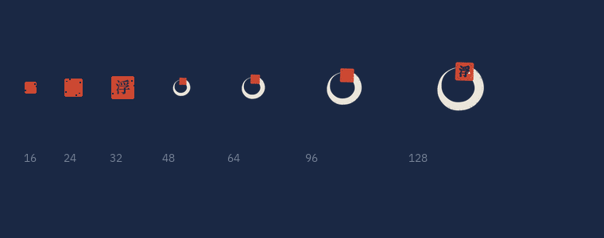

*16 to 128 px. Below 40 px the ring's gap closes up, so the stamp carries the mark; the character inside the stamp is
only drawn where it survives.*

### Type

Two faces, and neither of them is a fallback:

* **Shippori Mincho** — the display face. A Japanese Mincho whose Latin is cut with the same brush-derived contrast as
  the kana, so `UKIYO` and 浮世エンジン are visibly the same hand. Subset to the identity's own words and kana
  (206 KB per weight) and registered at startup by `editor::loadDisplayFont`.
* **IBM Plex Sans JP** — the interface face. One family covers Latin and Japanese, so a menu, a file path and a
  Japanese label sit in the same voice. Registered by `editor::loadBrandFont`.

A menu should not look like a logo: the display face is for the mark, the splash and the brand moments, and Plex is for
the work. Both are SIL OFL; their licences sit beside them in `editor/res/fonts/`.

### Palette

| | | |
| --- | --- | --- |
| `#F1EBDF` | ink | the paper of a print |
| `#CC4832` | vermilion | 朱 — the seal, and the only accent |
| `#1A2844` | indigo | 藍 — the night ground |
| `#B0A698` | muted | the second line of a lockup |

### The splash

Two beats, both painted by `splash_screen.cpp`:

1. **The mark**, alone on the indigo ground, settling a hair in scale as it fades up.
2. **The artwork**, with the lockup in the open sky at the left and the status block beneath it in the same column. A
   horizontal wash runs from the margin to two thirds across — dense enough to seat the type, gone before it reaches the
   island — and a foot gradient carries the bar.

Everything is laid out on a 960 × 540 grid and multiplied by `s`, so the screen keeps its proportions on any display.
`ukiyo_hub --splash-shots renders` paints both beats offscreen, which is how the images above exist without a display.


*Beat one, captured by the same command: the mark alone, settling on the indigo ground.*

Regenerate the identity with:

```sh
python3 tools/brand.py .     # needs pillow + numpy
```

This writes the mark at 512/256/128 px and its stamp form at 64 and 32, the seal alone, the horizontal lockup, the
stacked splash mark and the README plate into `editor/res/brand/` and `docs/brand/`.

## Textures

`editor/res/terrain/` carries the reference project's ground set — `Grass_Moss`, `Heather` and `Muddy`, each as albedo,
normal and AO, converted from TIFF and from HDRP's mask map. That is **9 of the 9 ground maps** the terrain shader can
read, plus `plant_detail` for the grass scatter. The other 30 files in the reference's `Textures/Details/` are billboard
plant cards (bush, fern, dry grass), which this engine does not draw: its grass is procedural geometry. `NOTICE.md`
beside the textures records the file-by-file mapping, and `tools/verify_terrain_textures.py` checks the claim in CI —
every layer present, the right size, three genuinely different images, and normal maps that are actually tangent-space.

## Repository layout

```
assets/            sample models, animation library, LUTs, shaders
docs/              the long-form docs, screenshots and the brand sheets
editor/            hub + editor (Qt), resources, fonts, brand marks
src/app/           the standalone viewer
src/engine/        renderer, terrain, grass, vgeom, model, animation, motion matching, …
src/input/         the Input System: assets, runtime, GLFW backend
src/rhi/           Vulkan and OpenGL backends
src/systems/       physics, audio, network, navigation, scripting, vfx, world
tests/             CPU tests and GPU regression programs
tools/             shader compiler, pak tool, offline previews, brand builder, asset checks
third_party/       Jolt, meshoptimizer, Lua, miniaudio, Recast, cgltf, stb, nodeeditor, …
```

About 59 000 lines of C++ and 56 shaders.

## Tests and CI

Two jobs run on every push. **Linux** installs the dependencies, builds every target and runs everything below;
**Windows** builds the same tree with MSVC and Ninja and runs the seven portable tests, so a POSIX assumption or an
`<unistd.h>` cannot sit in the engine unnoticed. Compilation goes through ccache on Linux and the Qt and vcpkg packages
are cached on Windows, so a one-file change costs a recompile of that file and its dependents, not of the engine.

Linux builds every target, and then runs:

```sh
./build/systems_test       # physics, Lua, world, navigation, water, LOD, terrain, grass, foliage
./build/network_test
./build/project_test
./build/vgeom_test
./build/motion_test
./build/input_test
./build/gi_test            # the estimator's numbers against the tracer
python3 tools/verify_terrain_textures.py --repo .
python3 tools/shader_bindings.py shaders
UKIYO_RT_MAX_RMSE=0.05 ./build/pathtrace_preview realtime renders/gi-realtime.png . 480 270 8 4 32
./build/motion_demo renders/motion-demo.png
QT_QPA_PLATFORM=offscreen ./build/ukiyo_hub --selftest
QT_QPA_PLATFORM=offscreen ./build/ukiyo_hub --screenshots renders
QT_QPA_PLATFORM=offscreen ./build/ukiyo_hub --splash-shots renders
```

The renders are committed to `docs/` and uploaded as an artifact, so a graphics change can be looked at without a local
GPU — the screenshots in this README are that pipeline's output. `tests/` also carries GPU regression programs
(`lod_gpu_test`, `endfield_gpu_test`, `particles_gpu_test`, `water_render`) that run where there is a device.

Windows takes its packages from two places: Qt from `install-qt-action` and glslang from vcpkg, because the Vulkan SDK's
own glslang package is generated with a broken SPIRV-Tools path; everything else is vendored. The reasons are in
`.github/workflows/build.yml` beside the steps that do it.

## Documentation

| Doc | What it covers |
| --- | --- |
| [docs/TERRAIN.md](docs/TERRAIN.md) | heightmap tiles, layers, atlas, brushes, culling |
| [docs/GRASS.md](docs/GRASS.md) | the MagicGrass adaptation: scatter, bands, wind, RHI limits |
| [docs/VGEOM.md](docs/VGEOM.md) | the cluster hierarchy, the cut, the cache, measured costs |
| [docs/MOTION.md](docs/MOTION.md) | the feature vector, the KD-tree, the controller, the retarget |
| [docs/PATHTRACE.md](docs/PATHTRACE.md) | the CPU reference tracer, the traced-bounce estimator, and the iGPU argument |
| [docs/INPUT.md](docs/INPUT.md) | action maps, the `.inputactions` format, the Unity semantics kept, the CI test |
| [docs/AO.md](docs/AO.md) | the multi-bounce AO fit, where the albedo comes from, and why the post pass clamps it |
| [docs/CONTACT_SHADOWS.md](docs/CONTACT_SHADOWS.md) | the contact-shadow march: parameters, why per pixel, and what the test pins |
| [docs/PCSS.md](docs/PCSS.md) | percentage-closer soft shadows: the two passes, the receiver slope, the foreshortening, the numbers |
| [docs/MSDF.md](docs/MSDF.md) | multi-channel distance fields for text: the colouring rule, the shader's one line, the measurements |
| [docs/INSPECTOR_SEARCH.md](docs/INSPECTOR_SEARCH.md) | the Inspector's search: words, globs, values, negation, and what happens to a section |
| [docs/WIREFRAME.md](docs/WIREFRAME.md) | the wireframe view: one flag, two backends, and why the fullscreen passes stay filled |
| [docs/ASYNC_LOADING.md](docs/ASYNC_LOADING.md) | loading with a frame budget: whole steps, measured budgets, counted overruns |
| [docs/FLAX.md](docs/FLAX.md) | Flax 1.10–1.13 surveyed: what this engine has, what it can take, and in what order |
| [docs/ALPHA_MIPS.md](docs/ALPHA_MIPS.md) | alpha-coverage-preserving mipmaps: the measurement, the search, and the chain upload |
| [docs/TRAIL.md](docs/TRAIL.md) | trail ribbons: sections, the width curve and gradient, the alignment and tiling modes, the test |
| [docs/SEARCH.md](docs/SEARCH.md) | fuzzy asset ranking and the glob grammar, and why the ranking is deliberately not "contains" |
| [docs/FILESYSTEM.md](docs/FILESYSTEM.md) | the browser's wheel zoom (the 32–224 ladder) and glob search, and the Android/Windows/Linux CI matrix |
| [docs/GAME.md](docs/GAME.md) | Lantern Run and Afterglow: the projects, their scripts, generated art and exports |
| [docs/PACKAGING.md](docs/PACKAGING.md) | `ukiyo_pack`: what a build contains, why the layout mirrors the project, and verification |
| [docs/ANDROID.md](docs/ANDROID.md) | the APK: native activity, asset staging, touch controls, and what is not on the phone yet |
| [docs/LUA.md](docs/LUA.md) | the sandbox, the hooks and the API, require(), errors, the built-in Lua editor, and the files an external IDE reads |

## Credits

* Virtual geometry follows [Jacinth-19/nanite-at-home](https://github.com/Jacinth-19/nanite-at-home); motion matching
  follows [Jacinth-19/MotionMatchingInUnity](https://github.com/Jacinth-19/MotionMatchingInUnity), which uses the
  [LAFAN1](https://github.com/ubisoft/ubisoft-laforge-animation-dataset) dataset. In both cases the reference supplied
  the assets and the pipeline, and the implementation here is the engine's own — in C++, against this RHI.
* Grass scatter and the ground texture set follow
  [Jacinth-19/UnityGrassIndirectRenderingExample](https://github.com/Jacinth-19/UnityGrassIndirectRenderingExample).
  The terrain textures are the reference's `Grass_Moss`, `Heather` and `Muddy` sets, converted from TIFF to PNG and from
  HDRP's mask map to an AO map; `NOTICE.md` records the mapping, and the coverage is checked in CI.
* The path tracing reference is [ColinLeung-NiloCat/NiloPathTracing](https://github.com/ColinLeung-NiloCat/NiloPathTracing),
  which needs an RTX card, DXR and DLSS Ray Reconstruction. Nothing of it can run on an iGPU, which is the point of
  [docs/PATHTRACE.md](docs/PATHTRACE.md): the estimator reaches the same bounce in a fragment shader instead.
* Animation library: Quaternion Universal Animation Library (CC0). Sample characters: Alicia Solid and Seed-san (VRM).
  Physics: Jolt. Mesh simplification: meshoptimizer. Icons: Material Symbols (Apache 2.0). Type: Shippori Mincho and IBM
  Plex Sans JP (SIL OFL).

## Status

The engine builds and tests on Linux and Windows CI, and the editor and hub run on Windows, Linux and macOS. Known gaps are listed
at the end of each doc — the largest were GPU virtual geometry and the mixer; the cut now runs on the compute queue
with indirect draws ([docs/VGEOM.md](docs/VGEOM.md) §7) and the mixer ships three buses, reverb and streaming
([docs/AUDIO.md](docs/AUDIO.md)). What remains there is page streaming and Hi-Z occlusion. The
traced bounce light does not see creases narrower than 5 cm, and that has been measured rather than estimated: closing
it changes 0.35 % of pixels in the reference and costs 17 % more march, which is why it is a documented trade
([docs/PATHTRACE.md](docs/PATHTRACE.md)).
