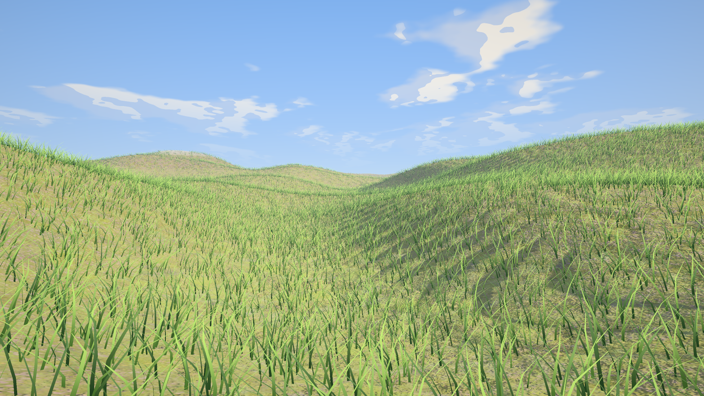
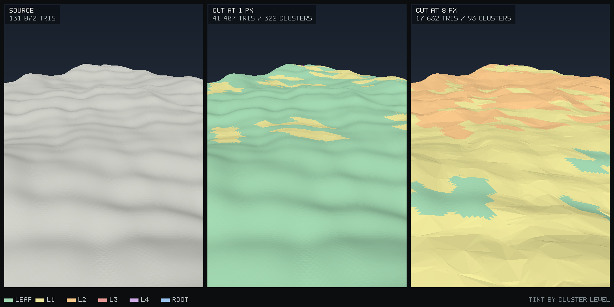
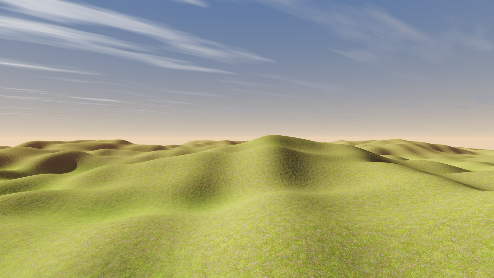
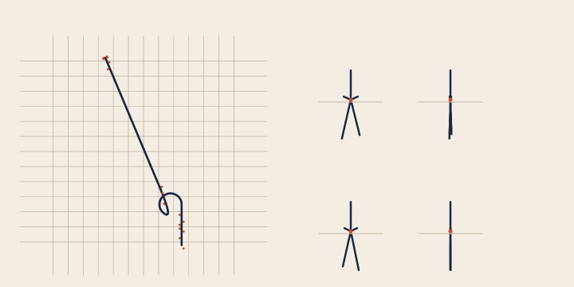
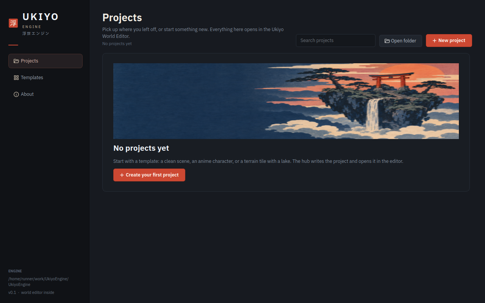
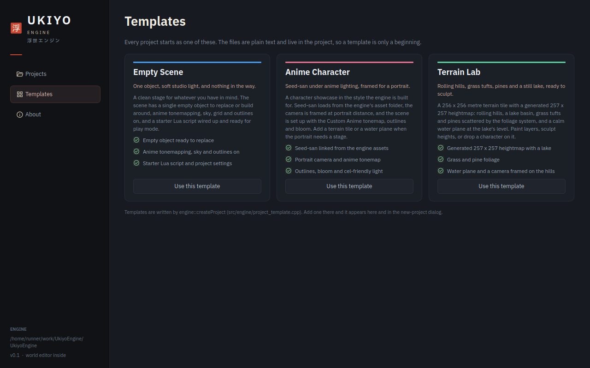
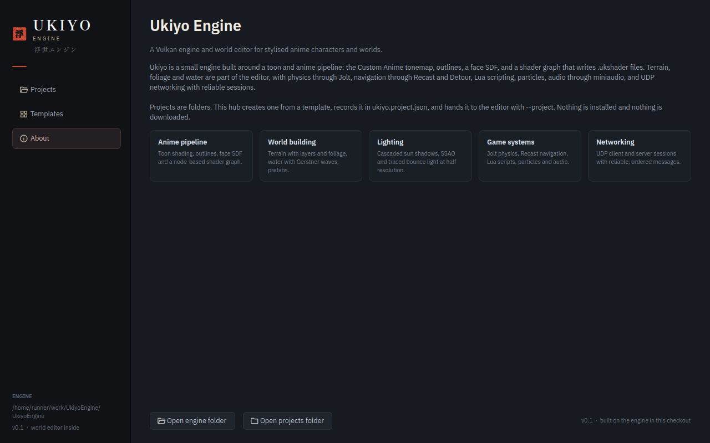

# Ukiyo Engine


A C++17 game engine and world editor with an anime-leaning renderer: cel shading with depth-aware outlines, a layered
terrain with grass, virtual geometry for static meshes, an animation stack with humanoid retargeting and motion
matching, Jolt physics, Lua scripting, Recast navigation, networking and a project hub.

The workspace is three programs and two libraries:

* **Ukiyo Hub** (`ukiyo_hub`) — the launcher: recent projects, templates, new-project dialog.
* **Ukiyo World Editor** (`ukiyo_editor`) — the editor: viewport, hierarchy, inspector, terrain brushes, animation
  panel, shader graph, material editing, play mode.
* **ukiyo** (`ukiyo`) — the standalone model viewer used for regression shots and GPU tests.
* **`ukiyo_core` / `ukiyo_systems`** — the engine libraries both programs link.

## Screenshots

| | |
| --- | --- |
|  |  |
| The Terrain Lab tile with the vendored ground textures and grass, rendered offline by `terrain_preview` (see [docs/TERRAIN.md](docs/TERRAIN.md)). | The same 131 072-triangle tile built into a virtual-geometry cluster tree, cut at 1 px and 8 px (see [docs/VGEOM.md](docs/VGEOM.md)). |
|  |  |
| The same scene through a CPU path tracer — one cosine bounce, ray-marched sun shadows, the engine's layer weights and textures. The ground truth the real-time renderer is measured against, and it runs on any machine (see [docs/PATHTRACE.md](docs/PATHTRACE.md)). | Ten seconds of motion matching: the route, the footprints, and four poses from the run. Walk, run and idle are chosen by the matcher from 900 database entries (see [docs/MOTION.md](docs/MOTION.md)). |

The hub is the first thing anyone sees, so it is checked like a screen and not like a build artifact: CI captures its
three pages offscreen with `ukiyo_hub --screenshots renders` and commits them to `docs/hub/`, so the images below are
the program at the commit you are reading, not a mockup.

| | |
| --- | --- |
|  |  |
| The Projects page: what you had open, a search, and the empty state that leads to a template. | The Templates page: the three starters the engine ships, with what each one gives you. |



*The About page. The rail carries the hanko seal at 26 px — the ensō's gap closes at that size and reads as a letter
C, so small sizes use the stamp instead — with the wordmark and 浮世エンジン beside it.*

## Quick start

### Dependencies

* CMake 3.20+, a C++17 compiler
* Vulkan SDK and GLFW 3 (`libvulkan-dev`, `libglfw3-dev`)
* GLM, nlohmann-json, glslang (the engine compiles generated shaders to SPIR-V at runtime)
* Qt 6 base + tools for the hub and the editor (`qt6-base-dev`, `qt6-tools-dev`)

On Debian/Ubuntu the whole set is:

```sh
sudo apt-get install -y cmake g++ libglfw3-dev libvulkan-dev glslang-tools \
    libglm-dev nlohmann-json3-dev glslang-dev qt6-base-dev qt6-base-dev-tools \
    libqt6opengl6-dev qt6-tools-dev qt6-tools-dev-tools
```

### Build and run

```sh
cmake -B build -DCMAKE_BUILD_TYPE=Release
cmake --build build --parallel 4
./build/ukiyo_hub            # launcher
./build/ukiyo_editor         # editor, opens the checkout as its project
./build/ukiyo model.glb      # model viewer
```

Shaders are compiled from `shaders/` into `build/shaders/` by `tools/shaderc.py` as part of the build. There is a
Vulkan backend and an OpenGL backend; `--backend gl` selects the latter.

## What is in the engine

### Rendering

* **Two RHI backends** — Vulkan and OpenGL behind `src/rhi/rhi.h`, with the same pipelines, descriptor sets and
  render passes.
* **Cel shading** — a two-band toon ramp with a soft terminator, rim light, depth-aware outlines and a scene-tuned
  grade. `Custom Anime` tonemap, bloom, vignette, FXAA/SSAA/TAA and LUT grading.
* **Terrain** — heightmap tiles with up to eight layers blended by height, slope and paint; a layer atlas; slope-
  aware triplanar mapping; normal, AO and detail overlays; brush editing; far-field culling. See
  [docs/TERRAIN.md](docs/TERRAIN.md).
* **Grass** — jittered scatter per ground cell with detail-map thinning, three distance bands, per-blade bezier wind
  and widening, and a chunked indirect-friendly draw. See [docs/GRASS.md](docs/GRASS.md).
* **Virtual geometry** — static meshes are clustered into a 128-triangle hierarchy with per-cluster error and drawn
  through a screen-space cut, cached beside the model. See [docs/VGEOM.md](docs/VGEOM.md).
* **Path-traced reference** — `tools/pathtrace_preview` renders the terrain on the CPU with true bounces and exact sun
  shadows, at whatever sample count the machine can afford. No RT cores, no DLSS, no GPU at all. See
  [docs/PATHTRACE.md](docs/PATHTRACE.md).
* **Shadows** — three cascades into a 3 × 2048² atlas, slope-scaled bias, PCF.
* **Water, particles, foliage, face SDF, PMX models**, and a shader graph with a node editor that generates
  GLSL and compiles it to SPIR-V at runtime.

### Animation

* glTF/VRM loading, humanoid retargeting, crossfades, idle state machine, clip editing (`.ukanim`).
* **Motion matching** — BVH motion capture into a 33-dimensional feature database (trajectory, feet, and a pose
  descriptor), a KD-tree over the 17 dimensions that separate one gait from another, a full-skeleton pose cost, and
  inertialized playback, plus a controller that turns stick input into a world-space pose. All 77 LAFAN1 captures —
  490 000 poses — build in 0.7 s and match in 0.37 ms. The capture reader trims the T-pose calibration hold and takes
  the character's forward from the toes, both of which the corpus proved necessary. See
  [docs/MOTION.md](docs/MOTION.md).
* Two-bone and FABRIK arm IK, hand-on-waist constraints, spring bones, hit reactions and sway.

### Systems

* **Jolt** rigid bodies and character controllers, colliders written by the editor.
* **Recast/Detour** navigation and pathfinding.
* **Lua** scripting with a bound world API; prefabs, scenes and materials are JSON.
* **Audio** through miniaudio; **networking** over UDP with snapshots and interpolation.
* **Virtual file system** with a pak format (`tools/ukiyo_pak.cpp`), so a shipped project is one folder.

## The editor

The editor is a Qt Widgets application with a custom viewport. It has a hierarchy, inspector, asset browser, terrain
paint/sculpt tools with a brush preview, a material inspector with live thumbnails, a shader graph editor, an
animation timeline and blend panel, gizmos, prefab mode, play mode, a benchmark scene and a project-settings dialog
(Quality, Graphics, Lighting). Projects are made by the hub from templates and opened directly.

## Repository layout

```
assets/            sample models, animation library, LUTs, shaders
docs/              the long-form docs, screenshots and the brand sheet
editor/            hub + editor (Qt), resources, fonts, brand marks
src/app/           the standalone viewer
src/engine/        renderer, terrain, grass, vgeom, model, animation, motion matching, …
src/rhi/           Vulkan and OpenGL backends
src/systems/       physics, audio, network, navigation, scripting, vfx, world
tests/             CPU tests and GPU regression tests
tools/             shader compiler, pak tool, offline previews, shader graph tools, brand builder
third_party/       Jolt, meshoptimizer, Lua, miniaudio, Recast, cgltf, stb, nodeeditor, …
```

## Tests and CI

Every push builds everything and runs:

```sh
./build/systems_test
./build/network_test
./build/project_test
./build/vgeom_test        # 29 checks
./build/motion_test       # 48 checks
./build/motion_demo renders/motion-demo.png
QT_QPA_PLATFORM=offscreen ./build/ukiyo_hub --selftest
```

The CI also renders the hub's pages and the terrain sample to PNGs and uploads them, so a graphics change can be
looked at without a local GPU. `tests/` also contains GPU regression programs (`lod_gpu_test`, `endfield_gpu_test`,
`particles_gpu_test`, `water_render`) that run where there is a device.

## Brand



The mark is an ensō: one brush ring with a vermilion hanko seal carrying 浮, the first character of 浮世 (*ukiyo*, the
floating world). It is drawn from vector maths by `tools/brand.py` rather than exported from a design tool, so the
repository holds the source, not just the raster:

```sh
python3 tools/brand.py .
```

This writes the mark at 512/256/128/64/32 px, the horizontal lockup and the stacked splash mark into
`editor/res/brand/`, and the review sheet into `docs/brand/`.

The typeface is **IBM Plex Sans JP** (SIL OFL, `editor/res/fonts/IBMPlexSansJP-OFL.txt`). One family covers Latin and
Japanese, so the UI can set `ENGINE` and 浮世エンジン in the same voice. The interface is English by default; the
Japanese line is the brand's second name, not a translation layer. The font is registered at startup by
`editor::loadBrandFont`, so a machine with no Japanese fonts installed still renders the mark correctly.

## Documentation

| Doc | What it covers |
| --- | --- |
| [docs/TERRAIN.md](docs/TERRAIN.md) | heightmap tiles, layers, atlas, brushes, culling |
| [docs/GRASS.md](docs/GRASS.md) | the MagicGrass adaptation: scatter, bands, wind, RHI limits |
| [docs/VGEOM.md](docs/VGEOM.md) | the cluster hierarchy, the cut, the cache, measured costs |
| [docs/MOTION.md](docs/MOTION.md) | the feature vector, the KD-tree, the controller, the retarget |
| [docs/PATHTRACE.md](docs/PATHTRACE.md) | the CPU reference tracer and the iGPU argument |

## Credits

* Nanite-style virtual geometry follows
  [Jacinth-19/nanite-at-home](https://github.com/Jacinth-19/nanite-at-home); motion matching follows
  [Jacinth-19/MotionMatchingInUnity](https://github.com/Jacinth-19/MotionMatchingInUnity), which uses the
  [LAFAN1](https://github.com/ubisoft/ubisoft-laforge-animation-dataset) dataset.
* Grass scatter and the ground texture set follow
  [Jacinth-19/UnityGrassIndirectRenderingExample](https://github.com/Jacinth-19/UnityGrassIndirectRenderingExample).
  The terrain textures in `editor/res/terrain/` are the reference's `Grass_Moss`, `Heather` and `Muddy` sets,
  converted from TIFF to PNG and from HDRP's mask map to an AO map; `NOTICE.md` beside them records the mapping.
  The `Details/` billboard plants (bush, fern, grass, heather) are *not* vendored — this engine's grass is procedural
  geometry, not billboards.
* Animation library: Quaternion Universal Animation Library (CC0). Sample characters: Alicia Solid and Seed-san
  (VRM). Physics: Jolt. Mesh simplification: meshoptimizer. Icons: Material Symbols (Apache 2.0).

## Status

The engine builds and tests on Linux CI, and the editor and hub run on Windows, Linux and macOS. Known gaps are
listed at the end of each doc — the largest are GPU-driven virtual geometry (no compute or multi-draw in the RHI
yet), real-time interreflection (the CPU tracer in [docs/PATHTRACE.md](docs/PATHTRACE.md) is the reference), and foot
locking in motion matching.
