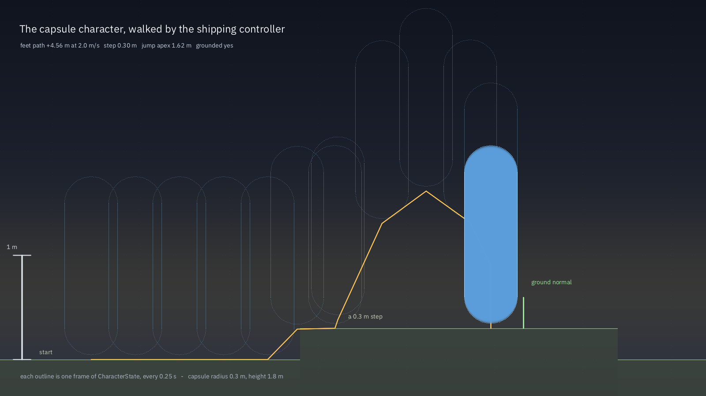

# The capsule character

A scene could contain rigid bodies, and they fell, stacked and tumbled. What it could not contain was a character — the
thing a player *is*: something that stands on a floor, walks up a kerb, refuses a cliff, and jumps when Space is pressed.
This document is that controller.



*1600×900, rendered by `tools/character_preview.cpp` on every CI push. It is not a drawing of a character: the tool builds
the same `PhysicsWorld` the tests use, drives a real `CharacterVirtual` at 2 m/s across a floor and up a 0.3 m step, jumps,
lands, and records `CharacterState` every 0.25 s. Each outline is one recorded frame; the amber line is the feet path; the
filled capsule on the right is the last frame, with the ground normal it reports. The measured numbers in the corner —
4.56 m of feet path, a 1.62 m jump apex, grounded at the end — are computed from those samples, so a regression in the
controller changes the figure.*

## 1. Why a kinematic capsule and not a rigid body

A rigid body does not work for a player, for two reasons that show up within the first minute of playing. A sphere body
on a 20° slope rolls or slides, and a box body on the same slope jitters as the solver trades a contact impulse for
gravity each step; neither stands still. And no rigid body climbs a step: a 0.4 m ledge is a wall, so the player has to
be thrown at it.

Jolt ships the right tool: `CharacterVirtual` is a *kinematic* capsule the game moves itself, and Jolt answers with where
it ended up, what it stands on and how far it slid. It has the step, slope and snap behaviour built in, and it is the
same class Godot 4.8's Jolt 5.6 binding exposes as `CharacterBody3D`'s back end. `src/systems/physics.cpp` wraps it; the
engine never touches Jolt's character types outside that file.

## 2. The API

```cpp
#include "systems/physics.h"

ukiyo::CharacterSettings s;      // radius .3, height 1.8, maxSlope 50, step .4, stickToFloor .35, jump 5, mass 70
ukiyo::PhysicsWorld phys;
ukiyo::CharacterHandle h = phys.addCharacter({0, 0, 0}, s);   // (feet position, settings)

ukiyo::CharacterState st;
phys.moveCharacter(h, {0, 0, -3.0f}, /*jump=*/false, dt, &st);  // planar velocity for dt, under gravity
phys.setCharacterYaw(h, 1.57f);                                   // radians about +Y
phys.characterState(h, &st);                                      // read without moving
phys.removeCharacter(h);
```

| Field | Default | Meaning |
| --- | --- | --- |
| `radius` | 0.3 m | Capsule radius. The capsule is a cylinder of `height - 2*radius` plus two caps. |
| `height` | 1.8 m | Total height, caps included. Must exceed `2*radius`. |
| `maxSlopeDeg` | 50° | Steeper ground is a wall: the character slides, and `onSteepGround` is set. |
| `stepHeight` | 0.4 m | The tallest ledge it walks up without jumping. |
| `stickToFloor` | 0.35 m | Downward snap, so walking down a slope does not become a hop-skip. |
| `jumpSpeed` | 5.0 m/s | Upward speed at the moment of a jump — about 1.27 m of height. |
| `mass` | 70 kg | The mass used when the character pushes a dynamic body. |

`CharacterState` is what a game reads each frame:

| Field | Meaning |
| --- | --- |
| `position` | The **feet**, not the centre. Add `height` for the head. |
| `velocity` | Horizontal, the last planar velocity actually applied. |
| `groundNormal` | The normal of what it stands on (world up when airborne). |
| `grounded` | Standing on something this step. |
| `onSteepGround` | Touching a slope too steep to stand on. |

The handle is a `uint32_t`; `0` means "none", the same convention as `PhysicsWorld::Handle`, and every call returns
`false` (or a `0` handle) for an unknown one rather than asserting.

### From an entity

`World` owns the entities, so a scene-facing game uses the thinner form:

```cpp
world.attachCharacter("Player", s);                       // needs a transformed instance called "Player"
world.setCharacterVelocity("Player", {x, 0, z}, jump);    // planar metres per second this frame
ukiyo::CharacterState st;
if (world.characterState("Player", &st) && st.grounded) { /* ... */ }
```

`World::updateCharacters(dt)` runs after `physics.step` inside `World::update` and turns the capsule to face its
velocity, so nothing has to call `setCharacterYaw` unless it wants to face somewhere else (aiming, strafing while
locked on). `Entity` gains `character`, `characterVelocity`, `characterJump` and `grounded`.

## 3. Coyote time, and the bug that made it necessary

The first test written for the jump pressed Space on the tick the capsule was created. Nothing happened, and the reason
is the interesting part: a `CharacterVirtual` reports `grounded` only after a move has been *extended* against the world.
On the frame a character is created, or on the frame it walks off a ledge, `grounded` is still false, so a jump pressed
there is dropped. Players notice this at precisely one place — the edge of a platform — and call it "sticky jumps".

So `moveCharacter` keeps `airTime`, the seconds since the character was last on the ground, and accepts a jump while
`airTime <= 0.1`. That is coyote time: 100 ms of grace, the window most action games settle on. After a jump, `airTime`
is set to `1.0`, past the window, so the same airtime cannot be spent twice — holding Space does not let a character jump
twice or hover.

The other clamp worth knowing: `dt` is clamped to `[1/240, 0.1]` before the move. The lower bound keeps a paused or
duplicated frame from producing a zero-length move (which Jolt reads as "not moving" and which would leave the capsule
embedding a step); the upper bound stops a 3-second hitch from tunnelling the capsule through a wall.

## 4. What the tests pin

`tests/character_test.cpp`, 29 checks, no GPU and no window — a `PhysicsWorld` with a heightfield, a wall, a step and a
60° ramp.

| Situation | Expected |
| --- | --- |
| Spawned above the floor, stepped for 2 s | Falls, lands, `grounded`, `groundNormal.y ≈ 1`, feet at y≈0 |
| `moveCharacter` with 3 m/s along −Z for 1 s | Travels ≈3 m along −Z, y stays 0, no drift sideways |
| Walks into a 3 m wall | Stops at the wall (z within one radius), does not pass through, stays grounded |
| Walks at a 0.3 m step | Climbs it: y rises by ≈0.3 and it keeps moving |
| Jump from rest, sampled every 1/60 s | Rises to ≈1.2 m, comes back down, lands, `grounded` again — never twice |
| Standing on a 60° ramp, sampled at 0.2 s | `onSteepGround`, `groundNormal.y ≈ 0.5`, no upward progress |
| Walked off the edge into the void | `grounded` false, y falls without a floor, no crash |
| `dt` of 10 s in one call | Clamped; the capsule does not tunnel through the floor |
| Two characters, different velocities | Independent state: neither follows the other's handle |
| `removeCharacter`, then `hasCharacter`/`moveCharacter` | `false`, and moving a removed handle is a no-op |

The tests deliberately check *numbers*, not flags: 3 m/s for 1 s must be 3 m ± 0.15, the step must be 0.3 m ± 0.02, the
jump must exceed 0.8 m and come back under 0.1 m. A controller that reports `grounded` but does not move is caught by
the same assertions.

## 5. In the editor

**Inspector → Systems → Character** is its own section, because a character *replaces* the rigid body: a capsule that
is also a dynamic body fights itself. The fields are radius, height, maximum slope, step height, jump speed and walk
speed, each with the per-field reset button the other sections have, and each written into the scene's
`components.character` object:

```json
"components": {
  "character": { "radius": 0.3, "height": 1.8, "maxSlope": 50, "stepHeight": 0.4, "jump": 5, "speed": 4 }
}
```

`SystemsComponents::character` is `enabled` when that object is present, and **Add Component → Character** turns it on
for every selected object at once, the same as the other systems. Ignoring a field falls back to the C++ default, so a
scene written by hand with only `{"speed": 2}` still loads.

**Play mode** drives every character in the scene from the game view: W and S move along the camera's forward axis, A and
D along its right, Space jumps, and the character always faces the direction it walks. The walk speed comes from the
component's `speed`, so the editor and the shipped player move a character at the same speed from the same data.

## 6. In the player

`ukiyo_player` looks for the first instance with a character component and drives it the same way, from the same keys,
relative to the scene camera's yaw. `ukiyo::PlayerApp::driveCharacter(dt)` is a dozen lines: read WASD, build a planar
vector in camera space, normalise it, multiply by `speed`, call `setCharacterVelocity`. Everything hard is in the
systems layer, where the tests can reach it.

## 7. What is not there yet

- **No animation hook.** The character reports a velocity; feeding it to a locomotion blend tree is the animation
  system's job, and the runtime's animation state is still authored per clip rather than per speed.
- **No moving-platform carry.** Jolt's character can be given a platform's velocity; the wrapper does not expose it yet.
- **No crouch or slide.** `height` is fixed at creation; changing it means rebuilding the shape, which is a stub.
- **The character does not push rigid bodies yet.** `mass` is stored and passed to Jolt's contact, but the collision
  response for a kinematic body is one-way until `CharacterVirtual::SetCharacterVsBody` is wired up.

## 8. Where it lives

| File | What |
| --- | --- |
| `src/systems/physics.{h,cpp}` | `CharacterSettings`, `CharacterState`, `addCharacter`/`moveCharacter`/`characterState`, coyote time, dt clamp |
| `src/systems/world.{h,cpp}` | `attachCharacter`, `setCharacterVelocity`, `characterState`, `updateCharacters` |
| `src/systems/components.h` | `CharacterComponent` and `SystemsComponents::character` |
| `src/engine/scene_runtime.cpp` | Reads `components.character` without Qt |
| `editor/src/systems_json.cpp` | Writes and reads the same object in the editor |
| `editor/src/main_window.cpp` | The Inspector's Character section and Add Component entry |
| `editor/src/engine_session.cpp` | Play mode: key state, camera-relative motion, HUD |
| `src/player/player_app.cpp` | The player's `driveCharacter` |
| `tests/character_test.cpp` | The 29 checks above |
