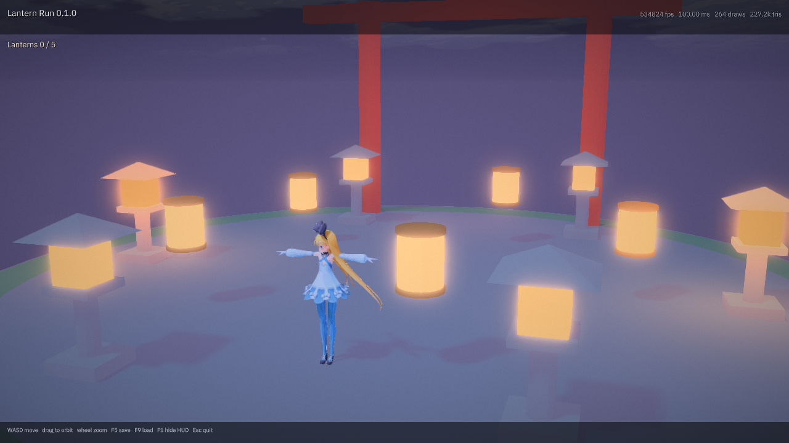
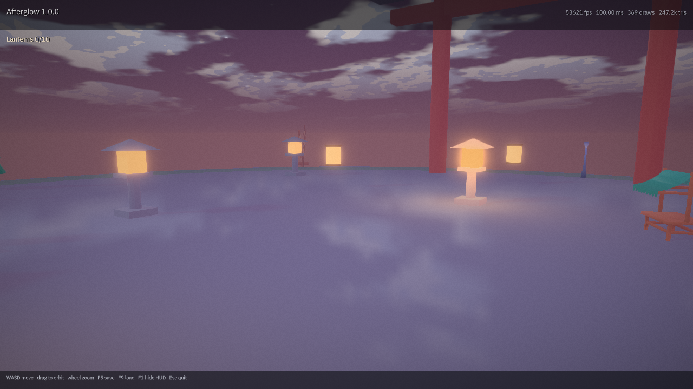

# Games: Lantern Run and Afterglow

The engine has had a player, a scene format and a script API for a while. What it did not have was a *game* — a project
that is not a test fixture, that someone can open, play and ship. There are two now. **Lantern Run** is deliberately
small: one courtyard, five paper lanterns, one character and one script — the project that proved a game was possible.
**Afterglow** is the one CI ships on every platform: a dusk village to relight, with saves, a soundtrack, localisation
and its own contract test. This page covers both; the first half is Lantern Run's story, the second is Afterglow's.

```
ukiyo_player --project games/lantern-run --build Build/build.json
```

WASD walks, the camera follows, Escape quits. Walk into a lantern and it lifts away with an ember burst; the HUD counts
them. When the fifth goes up, the torii answers with its own burst and the line under the title changes.



*The frame the `gpu` job captures from the packaged game, on lavapipe: `renders/lantern-run.png`, published to
`docs/lantern-run.png` by CI.*

## What it exercises

Every system in the game already existed; the game is the proof that they work together on a real project.

| System | In Lantern Run |
| --- | --- |
| VRM character | `Hero` is `assets/AliciaSolid_vrm-0.51.vrm`, driven by the capsule character controller |
| Scene format | `Scenes/NightCourt.ukscene` — 16 instances, one hierarchy level, five collectibles |
| Script API | `Scripts/game.lua` — `getPosition`, `setPosition`, `spawnEffect`, `hud` |
| Physics | the court's static box, so the character has a floor to walk on |
| Lights | one moonlight directional and three warm points, with PCSS shadows |
| Look | outlines, cel banding, bloom, SSAO, contact shadows, fog, ACES tonemapping |
| HUD | the player's own layout; the game writes one line into it |

The script is the part worth reading: it bobs each lantern around its rest position, measures the hero's distance in the
horizontal plane, and on a pickup moves the lantern out of the court and fires a particle burst. That is the whole game,
and it is 60 lines of Lua with no engine changes.

Two engine changes were needed to make a game *possible* rather than to make this one:

* **every instance gets an entity.** Previously only instances with a component did, so a script could not name a prop
  with no body — `ukiyo.setPosition("Lantern 3", …)` had nothing to move. An instance without a component is now an inert
  entity: a map entry, and nothing per frame.
* **`ukiyo.hud(text)`.** The player's HUD had a message line that only the player could write. A game can now write it
  too; the last line a script sets is what the frame shows, and an empty string leaves the engine's own messages alone.

## The art is code

`games/lantern-run/assets/*.glb` are generated, not drawn: `tools/lantern_assets.cpp` builds a stone platform, a torii
gate, a stone lantern and a paper lantern out of boxes, cylinders and cones, and writes them as glTF 2.0 binary.

```
./build/lantern_assets --out games/lantern-run/assets          # rewrite them
./build/lantern_assets --out games/lantern-run/assets --check  # fail if the committed files differ
```

CI runs the check, so the committed binaries and the generator cannot drift apart. 878 triangles for the whole court;
four files, 81 KB. The materials are simple on purpose — a base colour, an emissive factor for the paper — because they
are what the engine's loader reads from any glTF, and a first game should not depend on an exporter's extensions.

The character is a real asset either way: `assets/AliciaSolid_vrm-0.51.vrm`, a VRM 0.x model the engine's loader
already handles, referenced the way the player's own fixtures reference it (`../../assets/…`).

## Afterglow's assets are real

Lantern Run's four props stay generated — CI proves they match their tool. Afterglow is a village, and a village is
modelling work. `tools/fetch_afterglow_assets.py` copies thirty-four pieces from Kenney's Nature and Fantasy Town
kits — CC0, source URL and every sha256 baked into the tool — into `games/afterglow/assets/`: trees, rocks, fences,
stalls, a cart, a windmill, bamboo, campfire stones, path tiles, and the kits' shared palette texture the town
pieces reference from inside their own glTF. `python3 tools/fetch_afterglow_assets.py --check` runs in CI, so an
upstream re-upload cannot drift the game, and every pinned file appears in `Scenes/Village.ukscene`: paths laid
from each torii gate to the centre circle, a fence run inset from the east wall, bamboo in both far corners, the
windmill on the north-west skyline.

The soundtrack comes from recordings, too. `tools/afterglow_audio.py` mixes field wind, wind chimes, a bell tree, a
whoosh and sampled piano notes into exactly the three files `Scripts/game.lua` plays — 48 kHz mono PCM16 at the
durations `afterglow_test` measures — as a fixed schedule, so the same sources give byte-identical wavs every run.
The Oculus recordings are CC BY 4.0; Meta Piano is CC0. `games/afterglow/CREDITS.md` carries the attribution the
package ships with, and the audio tool's `--check` pins those wavs by hash in CI.

## Checking it

`game_test` runs in the portable job on Linux and Windows and needs no device. It loads the manifest, loads the scene
with the same reader the player uses, and checks the things that break silently:

* every instance's model path exists on disk;
* every GLB is a glTF 2.0 binary whose header length matches the file, with positions, normals and indices on every
  primitive, and at least the triangle count the game expects;
* the hero has a character component;
* the script names every lantern the scene places — a typo in a name is a lantern that can never be gathered, and the
  scene would still load perfectly;
* the lighting and the look are still what the game was designed with.

The device half is in the `gpu` job: it packages the game, runs the package's own launcher on lavapipe, and requires
`player: 1 script running`, no `player: warning:` line, and a frame that `tools/frame_check.py` accepts.

## Lantern Run's three builds

| Platform | What CI produces | Where it runs |
| --- | --- | --- |
| Linux | `lantern-run-linux.zip` and a folder package | the `gpu` job runs the package's launcher on lavapipe and captures `docs/lantern-run.png` |
| Windows | `lantern-run-windows.zip`, built and packaged by MSVC | not run in CI: the Windows runner has no Vulkan device |
| Android | inside `afterglow-android`: the project is staged alongside the flagship | built and signed, not launched: CI has no phone ([docs/ANDROID.md](ANDROID.md)) |

The desktop packages carry the player binary, the project tree at its repo-relative path (`games/lantern-run/…`), the
character and font it references, and the compiled shaders. The APK carries the same trees inside its assets.

## The shipped game: Afterglow

A dusk village, and everything anyone else lit has gone out. Four stone lanterns still burn and ten do not — four
stones and all six paper flames — and the walk is to remember each one back into the world: sparks, a chime, the path
brightening, the run saving itself. When the tenth takes, the gate answers. One biome, one verb, one thumb: there is
no interact key to bind and nothing a touch screen can miss, which is why the same game runs on a phone.

```
ukiyo_player --project games/afterglow --build Build/build.json
```



*The frame the `gpu` job captures from the packaged game, on lavapipe: `renders/afterglow.png`, published to
`docs/afterglow.png` by CI.*

### What it exercises that Lantern Run could not

The game was written *after* the systems it needs, and it is the reason each one exists:

| System | In Afterglow |
| --- | --- |
| Named scene lights | fifteen lights, every one named; `ukiyo.setLightEnabled` relights from Lua, `setLightIntensity` makes the paper flames flicker |
| Save slots | `saveSet`/`saveGet` into a `SaveGame` store, `saveWrite(0)` on every relight, `saveRead(0)`/`saveSlotExists(0)` on continue — `saves/slot0.uksv` |
| Localisation | `ukiyo.tr` in the HUD line; `assets/locales/en.json` and a real `ja.json`, loaded by the player from the project's base language or `--locale` |
| Soundtrack | `ukiyo.playMusic` streams `assets/music/dusk_loop.wav` (26.7 s loop), `playSound` the spark and the gate bell — all three written by `tools/audio_gen.py` |
| Touch | Android's virtual stick and look already run through the action maps; the game's own verb is proximity, so it needs no extra binding |
| HUD | `ukiyo.hud` progress line, translated, `Lanterns n/10` |
| Profile budget | the GPU profiler's slot timings over a scene with bloom, SSAO, contact shadows, PCSS and stars |

The script (`games/afterglow/Scripts/game.lua`) and the scene agree on a contract: the script addresses ten relights by
the exact names the scene gives them, and `afterglow_test` fails if either side moves. The scene keeps `enabled` states
as the truth — relight "Stone F" in the editor and it stops being a target, by itself.

### Checking it

`afterglow_test` runs in the portable job on Linux and Windows and needs no device: manifest, all a hundred and ten
instances and fifteen lights, every light named and uniquely, the exact set that starts dark, the script's hooks and
its references to the audio files, both locales present with a translated Japanese line, and WAV headers at 48 kHz
whose durations match what the music pipeline wrote. The device half sits next to Lantern Run's in the `gpu` job:
package it, run the package's launcher on lavapipe, require `player: 1 script running` and no warning, and a frame
`tools/frame_check.py` accepts.

### The three builds

| Platform | What CI produces |
| --- | --- |
| Linux | `afterglow-linux.zip`, and the `gpu` job runs it and publishes `docs/afterglow.png` |
| Windows | `afterglow-windows.zip`, packaged by MSVC |
| Android | `afterglow-android`: a signed APK labelled *Afterglow*, arm64 + x86_64, no Java; both games are staged in its assets and it boots Afterglow |

Lantern Run keeps its own packages and its own tests — it is the sample, and a sample that changes when the flagship
does is not a sample.

## Making it yours

Copy the folder, change `Build/build.json`'s `name`, and edit `NightCourt.ukscene`. The editor opens the same project:
`ukiyo_editor --project games/lantern-run`. Everything the scene uses — components, lights, settings — is the format the
editor writes; nothing here is player-only.
