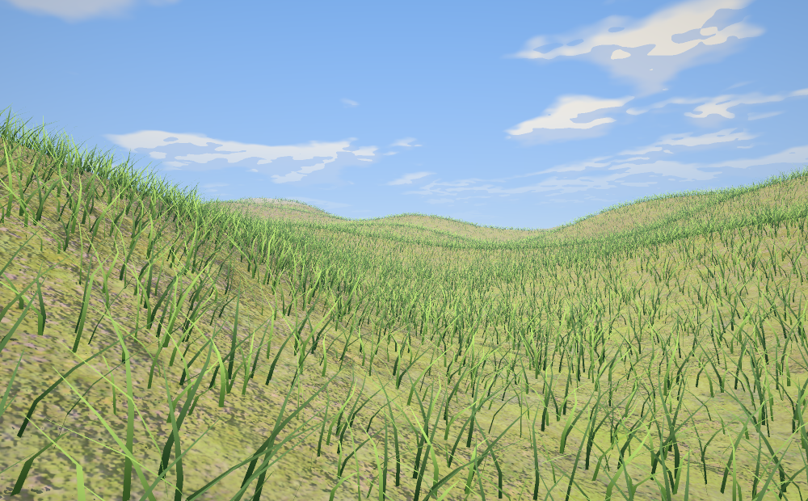

# Grass over terrain (item 19)

Ukiyo now grows grass on a terrain tile the way the reference project
[`Jacinth-19/UnityGrassIndirectRenderingExample`](https://github.com/Jacinth-19/UnityGrassIndirectRenderingExample)
does: jittered candidates per ground cell, a detail map that thins them, the terrain's own layer masks deciding where
they may grow, distance bands that drop blades as the ground recedes, and a wind that bends each blade by height.

It is **not** a port. The reference is a GPU-driven pipeline built on constructs Ukiyo's renderer does not have, so the
stages were re-cut for the hardware interface that exists here. This page is the honest mapping: what runs where, what
was changed, and what was dropped.



*The real scatter on `tests/data/terrain_hills_257.u16` at the new-project settings (4 tufts/m², eight blades of
0.44 m), with the vendored ground textures, rasterised offline by `tools/terrain_preview.cpp`. It is a look at the
geometry and the density, not an engine frame — the engine's own frame is `renders/terrain_grass.png`, written by the
hub self-test. [TERRAIN.md](TERRAIN.md) documents the ground, the preview tool and what it does not model.*

## What the reference does

| Stage | Unity (URP) |
| --- | --- |
| 1. Fetch | `IndirectDetailFetching.compute` walks 8×8 terrain cells, jitters one candidate per sub-cell with a voronoi/warp hash, samples `_DetailMap` × `_SplatChannels`, subtracts `_TerrainAlphaMaps` × `_ExcludeThreshold`, adds include layers × `(2 - _IncludeThreshold)`, reads the height and normal maps, and appends a 48-byte `MeshData {Position, Forward, Up, MaxDrawDistance, BandsFading}` to an `AppendStructuredBuffer`. Distance bands keep 1× / 2× / 4× candidates (near / mid / far) and set `BandsFading` on the band edge. |
| 2. Cull | `FrustrumCulling.compute` tests an 8-corner AABB and the view distance per instance, plus Hi-Z occlusion (a screen-space box picks a mip, then 8×25 taps against `_HiZMap`), and appends survivors. |
| 3. Draw | `IndirectDrawObject.shader` calls `Graphics.DrawMeshInstancedIndirect` with a 5-uint args buffer; `ComputeBuffer.CopyCount` copies the survivor count into `args[1]`. The vertex shader builds each blade's transform from `_MeshDatas[instanceID]`, bends it with a bezier wind (`_Wind1Frequency/Scale/Strength`, `_SwayAmplitude`), mixes a base and a tip colour, adds fake AO and translucency, dithers the LOD edge, and pushes blades out of the way of a fire/freeze interaction. |

## What Ukiyo's RHI has, measured

`src/rhi/rhi.h` is deliberately small. For this system the relevant facts are:

* `BufferUsage` is `{Vertex, Index, Uniform, Storage, Indirect}`. Storage buffers exist, and `Indirect` adds the
  draw-indirect flag (`STORAGE | INDIRECT` on Vulkan).
* `Device` has `draw`, `drawIndexed`, `drawInstanced`, `drawIndexedInstanced`, `drawFullscreen`, `dispatch` and
  `drawIndexedIndirect`; `PipelineDesc::computeShader` builds a compute pipeline on both backends, and the
  `SetType::Compute` descriptor set is four storage bindings.
* Timestamp queries for the GPU profiler are also in (`docs/PROFILER.md`).
* The per-draw data channels are the same as before: a 128-byte push block (`model` + `p0`–`p3`) and a
  `ShaderMaterial` descriptor set (textures, plus one uniform buffer at binding 15).

What is still absent is a counter **readback** — there is no `CopyCount` and no way to ask the GPU how many blades it
wrote without stalling. The engine's answer to that in the one system that has moved (virtual geometry,
`docs/VGEOM.md` §7) is the zero-command contract: pre-size the indirect region, let unwritten slots stay zero, draw
the whole capacity. `compute_test` proves the dispatch→storage→indirect→pixels round trip on both backends. This
item still adapts on the CPU — tested, small, no readback needed — and the paragraph below says what moving it would
now take.

## What runs where now

| Reference stage | Ukiyo | Why it is sound |
| --- | --- | --- |
| Jittered candidates per cell | `ukiyo::scatterGrass` (`src/engine/grass.cpp`), CPU, once per tile upload | The grid and the hashes are deterministic, so a tile rebuilds identically. There is no per-frame cost: the candidate set never changes. |
| Detail map, include/exclude layer masks | Same function, sampling `layerWeightsAtSample` at the candidate's sample | Uses the exact weights the terrain shader blends, so grass grows where the ground looks like it can grow grass. |
| Height from the heightmap, up from the normal | `Heightmap::heightAtMetres` / `normalAt`, blended by `groundAlign` | Same terrain the blades stand on. |
| Distance bands (1× / 2× / 4× candidates) | `grassDensityAt` + a stable hash in `shaders/grass.vert` | The curve is a continuous version of three bands: 1× inside `bandNear`, ½ at `bandMid`, 0 at `cullDistance`. The hash is of the blade's ground position, so the kept set only ever grows as the camera approaches — no flicker, and a near view is a strict superset of a far one. |
| Frustum culling of instances | `Renderer` culls each batch's chunk AABB (as foliage already did); `grassDensityAt` handles the distance | One AABB per 256 blades is coarser than per-instance, but it is the same test the rest of the engine uses. |
| Hi-Z occlusion | **Dropped** | It needs a depth pyramid and a per-instance survivor list; neither exists. The engine draws no occlusion culling for anything else either. |
| `DrawMeshInstancedIndirect` | `Renderer::pGrass_` + one `drawIndexedInstanced` per batch | Same GPU work, minus the indirect indirection. |
| Per-instance bezier wind | `shaders/grass.vert`: a travelling gust across the field, a per-blade flutter, a cantilever bend (`t²`), and a length correction | Same idea, evaluated in the vertex shader from the push block instead of from per-instance constants. |
| Base ↔ tip colour, fake AO, translucency | `shaders/grass.frag` | Tip colour on `uv.y`, root darkening, sun through the tip when looking towards the light. |
| Dither LOD edge | `vFade` (instances) + a 4×4 Bayer dither (pixels) | Blades thin out by distance, then the last band stipples away instead of ending on a circle. |
| Fire/freeze interaction push | `pc.p2`: a body in the grass pushes blades radially away | Same vertex-shader cost. The editor feeds it the active model's position, so a character standing in a field bends it. |
| Billboard toggle | **Dropped** | It needs a per-instance flag with a spare channel; the 48-byte row budget is spent on the transform. |

### The instance row, and the 48-byte budget

The reference stores `MeshData` in an SSBO. Ukiyo's equivalent is the uniform block at `ShaderMaterial` binding 15,
which is how foliage instances already travel. Each blade gets **three `vec4` rows (48 bytes)** — the same size as the
reference's `MeshData`:

```
row r = (basis.x[r] * scale, basis.y[r] * scale, basis.z[r] * scale, position[r])
```

so `dot(row[r], vec4(localPos, 1))` is the world position and the same rows are the blade's basis for the normal. A
batch of 256 blades is 12 KB, plus two `vec4`s for the root and tip colours — inside the 16 KB minimum uniform block
size, and the same batching idiom as `FoliageBatchGpu`.

Because a uniform block is per-descriptor-set, a tile is capped at `kGrassMaxInstances` (262 144 tufts, 3 rows each,
about 12 MB of rows). Past the cap the scatter keeps every n-th candidate — a fixed draw, so the result is still
deterministic — and this is reported in the terrain inspector. A true indirect pipeline would not need that cap.

## Knobs

`ukiyo::GrassSettings` lives in `src/engine/terrain.h` with the rest of a tile's settings, so it is saved in the same
terrain entry and read/written by `editor/src/scene_file.cpp` (`"grass"` object; a missing object means off).

| Group | Fields |
| --- | --- |
| Scatter | `enabled`, `density` (candidates/m²), `densityMap` (red channel), `seed`, `heightMin/Max`, `slopeMax` |
| Shape | `height`, `width`, `blades`, `segments`, `scaleMin/Max`, `groundAlign` |
| Bands | `bandNear`, `bandMid`, `cullDistance` |
| Masks | `includeLayers`, `includeThreshold`, `excludeLayers`, `excludeThreshold` |
| Wind | `windDir`, `windStrength`, `windFrequency`, `windScale`, `flutter` |
| Colour | `baseColour`, `tipColour`, `translucency`, `tipDarkening` |

A new project's template turns grass on for the sample terrain's moss and heather layers
(`src/engine/project_template.cpp`, `grassJson`), at 4 tufts/m², eight blades of 0.44 m, in a tuft whose roots sit on
a disc of 0.55 × the blade height. The editor exposes the useful half of the table under **Terrain → Grass**; the
layer masks and the two colours are edited in the scene file for now, the same way terrain layer bands are.

The blades are lit by the same cascaded shadows as everything else (`shadow_sample.glsl`, with the slope-scaled
receiver bias described in [TERRAIN.md](TERRAIN.md)), so grass under a ridge is genuinely in shade. Grass does not
cast into the atlas yet; that is the one shadow-side gap left, and it is a second instanced draw and no colour output.

## Tests

* `tests/systems_test.cpp`, `testGrass()` — 32 CPU checks: the scatter's determinism, the detail map, the include and
  exclude masks (including a paint map written the way the brush writes one), height and slope limits, scale and yaw
  ranges, the band curve and its monotonicity, the near/far subset property, chunk grouping, the instance cap, the
  tuft mesh, and that the packed rows place a blade's root and tip where they should.
* `tools/terrain_preview.cpp` — links this file and the terrain code and draws a still without a device. It is built by
  CI, so the scatter, the mesh and the settings are exercised together on every push.
* `ukiyo_hub --selftest` — three more checks that need a device: blades scattered on the sample tile change the frame,
  the scene document carries the grass settings, and turning grass off gives the frame back. The render is saved to
  `renders/terrain_grass.png`, which CI uploads as the `terrain-renders` artifact.

## What to do next, if this becomes a priority

The RHI was the obvious ceiling once; batch 4 removed it (storage, compute, indirect — above). What remains is the
grass project itself: the scatter and the layer tests move to a compute shader that only runs when the tile changes,
Hi-Z occlusion uses the depth buffer the frame already has, and the instance cap disappears — pre-sized indirect
regions make the missing counter readback a non-issue, as `docs/VGEOM.md` §7 shows. That is a renderer project, not
an RHI one, and this document's measurements still describe what ships today.
