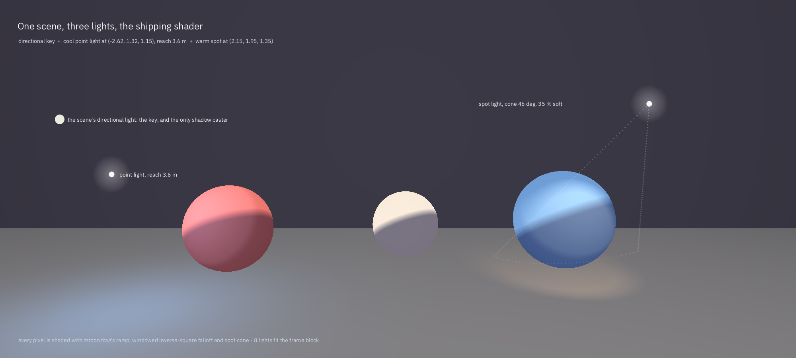

# Scene lights

Until this existed, a Ukiyo scene had exactly one light: a directional sun whose direction and intensity lived in the
project settings, plus two coloured fill lights baked into `renderer.cpp` at fixed coordinates — one pink at
`(1.4, 1.6, 1.2)`, one blue at `(-1.6, 1.3, 1.0)`. It was a good anime key/fill pair, and it was the only light a scene
could have. A lantern row, a neon sign, a muzzle flash or a character standing in a lit doorway could not be authored,
because there was nowhere to put them.

This is that: lights are scene objects, the renderer ranks them against the camera every frame, and the MToon shader
shades with them. A scene that authors none renders byte for byte as it did before.



*2000×900, rendered by `tools/lights_preview.cpp` on every CI push — not an illustration. The tool authors the same three
lights a `.ukscene` would carry (one directional key, one cool point light with a 3.6 m reach, one warm spot with a 46°
cone), selects them with the shipping `packSceneLights`, and ray traces a floor, a wall and three spheres, shading every
pixel with `shaders/mtoon.frag`'s arithmetic: the toon ramp on N·L, the windowed inverse-square falloff, the spot cone.
The red sphere sits in the point light, the middle one is lit only by the key, and the cool rim on the blue sphere is the
spot's own colour. If the shader's maths changes, the figure changes.*

## 1. What a light is

```cpp
struct SceneLight {
    LightType type = LightType::Point;   // Directional, Point, Spot
    glm::vec3 position{0, 2, 0};         // point and spot
    glm::vec3 direction{0, -1, 0};       // spot: the way the cone points. Directional: the way the light travels.
    glm::vec3 color{1, 0.9, 0.8};
    float intensity = 2.0f;
    float radius = 8.0f;                 // reach in metres; where the light has fallen to nothing
    float spotAngleDeg = 50.0f;          // the full cone angle, not the half
    float spotSoftness = 0.25f;          // fraction of the cone used for the soft edge, 0..0.95
    bool enabled = true;
};
```

In a scene file:

```json
"lights": [
  { "type": "directional", "direction": [0.35, -1.0, 0.45], "color": [1, 0.96, 0.9], "intensity": 1.4 },
  { "type": "point", "position": [-1.2, 1.6, 1.0], "color": [0.45, 0.7, 1.0], "intensity": 2.5, "radius": 5 },
  { "type": "spot", "position": [1.4, 2.2, -0.6], "direction": [-0.5, -1, 0.3], "color": [1, 0.72, 0.5],
    "intensity": 3, "radius": 6, "angle": 45, "softness": 0.35 }
]
```

A missing field takes the C++ default, so `{"type": "point"}` is a valid light. `enabled: false` keeps a light in the
file and out of the frame — the toggle authors use while lighting a scene.

## 2. One sun, and why

A directional light in the list becomes **the** key light: its direction, colour and intensity replace
`RenderSettings::sunDir` and `sunIntensity`, and the three shadow cascades are fitted to it. That is why there is only
one: the frame block carries one set of cascade matrices and the renderer draws one shadow atlas, so a second
directional light would silently light nothing.

A file with two directional lights is not an error: the first is the sun, and the second is read as a point light at its
position, which is what an author who wrote one probably meant. Both readers — the editor's
(`editor/src/scene_file.cpp`) and the runtime's (`src/engine/scene_runtime.cpp`) — do this, and both clamp the same
values, because a shipped game and the editor must shade the same file the same way:

| Field | Range | Why |
| --- | --- | --- |
| `intensity` | 0 … 64 | A light ten thousand times too bright turns the whole frame white and looks like a bug. |
| `radius` | 0.05 … 200 m | Zero reach is a light that lights nothing; an unbounded one fills the whole map. |
| `angle` | 1° … 179° | 0° is a laser, 180° is a point light with extra steps. |
| `softness` | 0 … 0.95 | The inner cone must stay inside the outer one. |

## 3. How a frame is lit

The renderer keeps the scene's list. Every frame it packs the point and spot lights into the frame block:

1. **Score.** `lightScore` = intensity × reach² ÷ (distance² + 1), damped ×0.35 for a light behind the camera. A light
   whose reach does not include the camera's focus scores zero.
2. **Rank**, brightest first, keeping author order on ties, so a scene renders identically every frame.
3. **Pack** the best `kFrameLights` (8) into `GpuLight` — four `vec4`s: position/radius, direction/cos(outer), colour/
   intensity, type/cos(inner) — and write the count into `lightParams.x`.

The shader then does:

```glsl
if (frame.lightParams.x < 0.5) {
    // no authored lights: the two stylistic fills, exactly as before
} else {
    for (int i = 0; i < 8; ++i) {
        if (i >= int(frame.lightParams.x)) break;
        ...
        float window = clamp(1.0 - dist / reach, 0.0, 1.0);
        float att = window * window / (1.0 + dist * dist);   // inverse-square, windowed to nothing at the reach
        if (type == spot) att *= smoothstep(cosOuter, cosInner, dot(-l, dir));
        color += mix(albedo * shadeTint, albedo, ramp(NdotL)) * lightColor * intensity * att;
    }
}
```

Two decisions are worth naming.

**The window.** A pure inverse-square falloff never reaches zero, so a light with a finite reach would still be adding
0.4 % at its edge and stop abruptly one centimetre past it: a visible ring on the floor. Multiplying by a squared
window that reaches zero *at* the reach removes the ring and keeps the light's shape.

**The toon band.** Each scene light is banded with the same ramp as the sun (`linearstep(-1 + toony, 1 - toony, N·L)`),
so a lantern gives a cel-shaded pool of light rather than a gradient. A light that only reads as a soft blob next to a
flat-shaded character looks like a different renderer drew it.

## 4. The frame block

`FrameUBO` grew by 528 bytes, from 1040 to 1568:

| Offset | Field |
| --- | --- |
| 0 | `view`, `proj`, `viewProj`, `invViewProj`, `shadowMatrix[3]` |
| 576 | `pointPos[4]`, `pointColor[4]` — the two fills, still there |
| 704 | `lightParams` |
| 720 | `lights[8]`, 64 bytes each |
| 1232 | `toonA` … the rest |

`tests/lights_test.cpp` asserts those offsets with `static_assert`, and `lights.h` asserts `kFrameLights <=
kMaxSceneLights`, so a change to the block that the shader does not know about fails the build rather than the frame.

## 5. In the editor

**Hierarchy → right-click → Create → Point Light / Spot Light**, or the same two entries in the Create menu, adds a
light two metres in front of the camera at eye height — visible where the author is looking. Each gets a row in the
Hierarchy (`Point Light 1`, `Spot Light 2`, greyed when off), a right-click **Delete Light**, and an Inspector page:

| Control | Writes |
| --- | --- |
| Type: Point / Spot | `type` |
| Position (x, y, z) | `position` |
| Direction (x, y, z) | `direction` |
| Colour (r, g, b) | `color` |
| Intensity | `intensity` |
| Reach (m) | `radius` |
| Cone (deg) | `angle` |
| Cone softness | `softness` |
| On | `enabled` |

Every field writes the list **and** the render thread immediately, so the viewport changes as the spin box does. The
list is saved as the scene's `lights` array — only when it is not empty, so a scene written before lights existed keeps
its exact bytes. The project's own sun is still a separate page (**Directional Light**), because it always exists and its
intensity is a project setting.

## 6. What is still missing

- **No shadows from scene lights.** Only the sun casts; a point light shines through a wall. Shadow cubes and spot
  shadow maps are the next step, and they need an atlas per light.
- **No per-object culling.** The eight lights are chosen for the camera, not per object, because the RHI has no way to
  pass a per-draw light mask yet. A scene with twenty lanterns in separate rooms will spend its eight slots on the
  nearest, not the right ones.
- **No light probes** and no baked contribution: the ambient stays a hemisphere.
- **No emissive-to-light coupling.** An emissive material glows but does not light its surroundings.
- **No gizmo.** A light is placed by numbers on the Inspector page; a drag handle in the viewport is not there yet.

## 7. Where it lives

| File | What |
| --- | --- |
| `src/engine/lights.{h,cpp}` | `SceneLight`, `lightScore`, `packSceneLights`, cone maths |
| `src/engine/gpu_types.h` | `GpuLight`, `kFrameLights`, the `lights` array in `FrameUBO` |
| `shaders/frame.glsl` | `BlockLight` and the block members |
| `shaders/mtoon.frag` | The fill branch and the scene-light branch |
| `src/engine/renderer.{h,cpp}` | `setSceneLights`, key light from a scene, per-frame ranking |
| `src/engine/scene_runtime.cpp` | The player's reader, with clamps |
| `editor/src/scene_file.cpp` | The editor's reader and writer |
| `editor/src/main_window.cpp` | Hierarchy rows, the light page, Create menu, delete |
| `editor/src/engine_session.cpp` | The worker's copy, applied to the renderer |
| `src/player/main.cpp` | `setSceneLights` at start and on a scene switch |
| `tests/lights_test.cpp`, `tests/scene_runtime_test.cpp` | Layout assertions and clamping |
