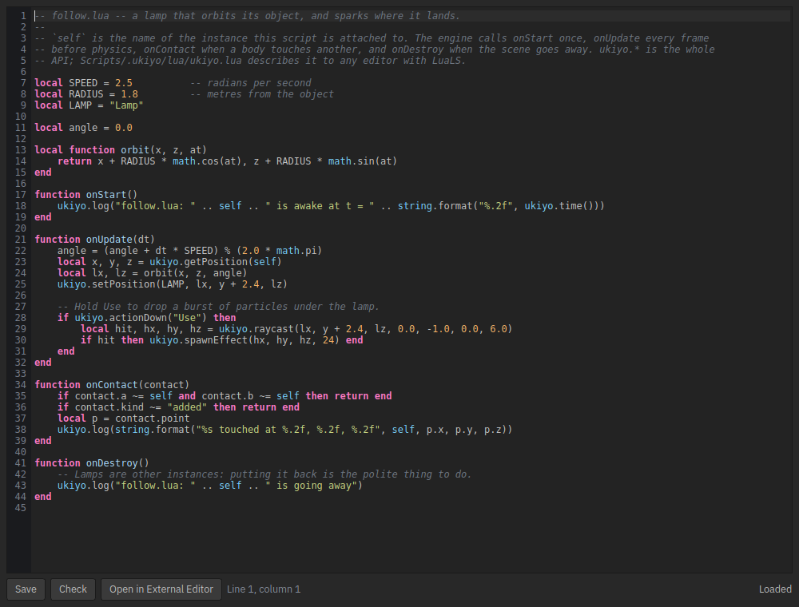
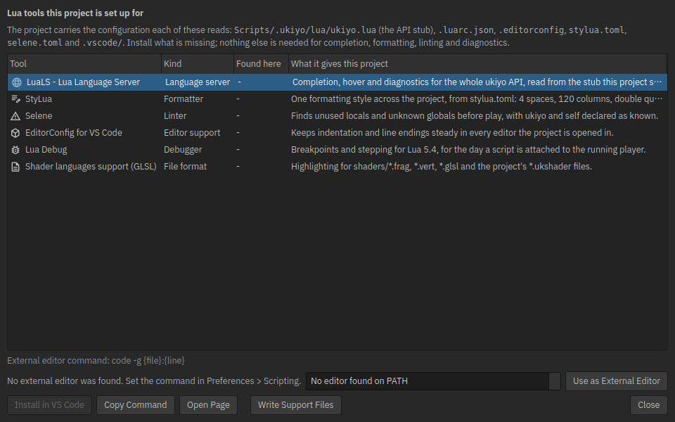

# Lua scripting

Scripts are Lua 5.4 files that a scene's objects run while the level plays. Every object can carry its own script, and
every script gets its own Lua state, so two actors never share globals. A script talks to the engine through one table,
`ukiyo`, and hears from it through five hooks.



*The editor's Lua window, drawn by the editor itself in CI (`tools/script_editor_demo.lua`): syntax highlighting, line
numbers, the current line, Save / Check / Open in External Editor, and the cursor position.*

## Where scripts live

| Folder | Used for |
| --- | --- |
| `Scripts/` | A project's own code. This is the folder `require()` searches first. |
| `assets/` | Code that travels with a model or a prefab, next to it. Also searched by `require()`. |
| `Scripts/.ukiyo/lua/` | The API stub. Written by the editor; read by tools, never run. |

A new project is created with `Scripts/hello.lua`, a module it requires (`Scripts/clock.lua`), and the support files
below, so the first script already runs and already completes in an editor.

## A script

```lua
-- self is the name of the instance this script is attached to.
local speed = 2.0
local angle = 0.0

function onStart()
    ukiyo.log("hello from " .. self)
end

function onUpdate(dt)
    angle = angle + dt * speed
    local x, y, z = ukiyo.getPosition(self)
    ukiyo.setPosition(self, x + math.cos(angle) * 0.01, y, z + math.sin(angle) * 0.01)
end
```

The hooks, in the order a level runs them:

| Hook | When |
| --- | --- |
| `onStart()` | Once, when the script is loaded (play starts, or `Check and Reload` runs). |
| `onUpdate(dt)` | Every frame, before physics steps. `dt` is seconds, already scaled by the time scale. |
| `onContact(contact)` | For every physics contact involving this entity. `contact.kind` is `"added"` or `"removed"`, `contact.a`/`contact.b` are entity names, `contact.point`/`contact.normal` are `ukiyo.Vector3`. |
| `onSceneLoaded()` | Once the whole scene is up: every entity exists, so this is where a script finds others. |
| `onDestroy()` | When play stops or the scene goes away. |

Any hook may be missing. A script with no `onUpdate` costs nothing per frame.

## The API

Every bound function lives in the `ukiyo` table — alongside `ukiyo.Vector3`, `ukiyo.Quaternion` and `ukiyo.Entity`.
The full list, with signatures and one line each, is `ukiyo::script_project::apiDocs()`; the editor stub is generated
from that same table, so the documentation and an editor's completion cannot drift apart, and `tests/script_test.cpp`
fails if the engine binds a function the stub does not declare (or documents one the engine does not bind).

```lua
ukiyo.log(message)                     -- the editor console and the player log
ukiyo.time()                           -- seconds since the world started
ukiyo.actionDown(action)               -- a Gameplay action is held by the local player
ukiyo.hud(text)                        -- the player's status line under the title (the game's own HUD line)
ukiyo.getPosition(name)                -- x, y, z
ukiyo.setPosition(name, x, y, z)       -- moves a body or an agent with it
ukiyo.moveTo(name, x, y, z)            -- an agent walks to a point on the navmesh
ukiyo.impulse(name, x, y, z)           -- newton-seconds on a dynamic body
ukiyo.setParam(name, param, value)     -- an animation parameter
ukiyo.playSound(path, entity?, bus?)   -- positional with an entity, 2D without; bus: music/sfx/ambient
ukiyo.playMusic(path, loop?, fade?)    -- streaming music, looped, faded in
ukiyo.stopMusic(fade?)                 -- fade the music out (0 = now)
ukiyo.setBusVolume(bus, volume)        -- music/sfx/ambient/master, 0..4
ukiyo.setBusReverb(bus, wet)           -- 0 dry .. 1 fully through the insert
ukiyo.frameTiming()                    -- last tick's ms by stage (profiler on)
ukiyo.setLightEnabled(name, on) / lightEnabled(name) / setLightIntensity(name, v)
ukiyo.saveSet(key, value) / saveGet(key) / saveHas(key)
ukiyo.saveWrite(slot) / saveRead(slot) / saveSlotExists(slot) / saveDelete(slot)
ukiyo.hudRect(x, y, w, h, r?, g?, b?, a?)  -- a solid HUD quad this frame (pixels, 0..1 colours)
ukiyo.spawnEffect(x, y, z, count?)     -- a one-shot particle burst
ukiyo.raycast(ox, oy, oz, dx, dy, dz, maxDistance)   -- false, or true and the hit point
ukiyo.setContactFilter(a, b, enabled)  -- stop or allow contacts between two entities
ukiyo.joinPlayer(scheme?)              -- index of a new local player
ukiyo.playerCount() / leavePlayer(i)
ukiyo.playerActionDown(i, action) / playerActionValue(i, action) / playerActionVector2(i, action)
ukiyo.loadScene(path) / holdLoad() / releaseLoad(token)
ukiyo.preloadModel(path)
ukiyo.Entity(name)                     -- .position (writable), .rotation (writable degrees),
                                       -- .yaw (writable, the y of .rotation), .name
ukiyo.Vector3(x, y, z)                 -- a value with arithmetic and a readable tostring
ukiyo.Quaternion.lookRotation(x, y, z)
```

Vectors are accepted as a `ukiyo.Vector3` or as three numbers, so both of these work:

```lua
ukiyo.setPosition("Lamp", 1.0, 2.5, 3.0)
ukiyo.setPosition("Lamp", ukiyo.Vector3(1.0, 2.5, 3.0))
```

## Modules

`require("name")` loads `Scripts/name.lua`, then `Scripts/name/init.lua`, then the same two under `assets/`. A dotted name
is a path: `require("lib.orbit")` is `lib/orbit.lua`. Each module is read once and cached, including the modules it
requires, so a table returned by a module is shared by every script that asks for it.

The loader refuses absolute paths, `..`, drive letters and hidden files, so a module is always inside one of the two
roots. A module that requires itself gets a placeholder instead of an infinite loop. A module that fails to load reports
its own file and line, not the caller's.

## Errors

A script that does not compile is reported at play start and the level still runs; the other objects keep their scripts.
The message carries the file, the line and the Lua explanation:

```text
script: Hero: /project/Scripts/hero.lua:3: attempt to index a nil value (local 't')
```

A runtime error is reported the same way, with a traceback in the log. A host that fails three times in a row stops
running, so one broken script cannot flood the console for a whole play session; the Play page says that it stopped.
Checking a script by hand (`Check` in the built-in editor, `Check and Reload Script` in the Inspector) compiles exactly
what the engine will run and does not execute it.

## The built-in editor

Double-clicking a `.lua` file in the Project browser opens it in the editor's Lua window (Tools and preferences can send
`.lua` to an external editor instead). It has Lua 5.4 highlighting — keywords, the standard library, `ukiyo` and `self`,
function names, numbers, short and long strings, short and long comments — line numbers, the current line in a subtle
highlight, and the error line in red. `Check` compiles the text on screen, marks the line Lua reports and moves the
cursor to it. `Save` writes the file, and the running level reloads it within a quarter second without stopping play.

Three more things a code editor is expected to have:

* **Completion from the API.** Typing three characters of a `ukiyo.*` name — or of `onStart`, `onUpdate`, `onContact`,
  `self`, `require` — opens a list built from the same table that writes the stub, so what the editor offers and what the
  engine binds cannot drift apart. `Enter` or `Tab` takes the choice; `Esc` dismisses it.
* **Hover documentation.** A pointer over `ukiyo.raycast`, a hook or `self` shows its signature and one sentence — the
  same entry that wrote the stub and the completion list.
* **Find.** `Ctrl+F` opens the find bar at the bottom of the window; `Enter` finds the next match and wraps, `Previous`
  walks back.
* **Indentation that follows the language.** A new line keeps the indentation, adds a level after `function`, `then`,
  `do`, `else` and `repeat`, and `Tab` inserts four spaces, the width the project's `.editorconfig` asks for.

## External IDEs

The same folder answers for any editor. `Tools > Write Script Support Files` (and every new project) writes:

| File | Read by |
| --- | --- |
| `Scripts/.ukiyo/lua/ukiyo.lua` | LuaLS: a `---@meta` stub with every function, the classes and the hooks. Editors do not run it. |
| `.luarc.json` | LuaLS: Lua 5.4, `workspace.library` pointing at the stub, `io`/`os`/`package`/`debug` disabled. |
| `.editorconfig` | Every editor, and StyLua / the LuaLS formatter: 4 spaces, LF, 120 columns. |
| `stylua.toml` | StyLua: the same values as a formatter that reads its own file. |
| `selene.toml` | Selene: `std = "lua54"`, with `ukiyo` and `self` as known globals. |
| `.vscode/extensions.json` | VS Code: recommends the extensions below, generated from the engine's own tool list. |
| `.vscode/settings.json` | VS Code: the language server's runtime and library. |

The stub and `.luarc.json` are rewritten every time the API changes; the rest are only written when they are missing, so
a project that has customised them keeps its version.

Recommended extensions — they are the tools these files are written for:

| Tool | Editor | Why |
| --- | --- | --- |
| **LuaLS** (`sumneko.lua`) | VS Code, Neovim (`lua_ls`), Zed (Lua) | Completion and hover for the whole `ukiyo` API, from the stub. Diagnostics follow the sandbox: no `io`, no `os`. |
| **StyLua** (`JohnnyMorganz.stylua`) | VS Code, or `stylua --lsp` | One formatting style across the project, from `stylua.toml`. |
| **Selene** (`Kampfkarren.selene-vscode`) | VS Code, or `selene` in CI | Catches unused variables and typos in `ukiyo.*` calls before play. |
| **EditorConfig** (`EditorConfig.EditorConfig`) | VS Code | Keeps indentation and line endings steady in every tool. |
| **Lua Debug** (`actboy168.lua-debug`) | VS Code | Breakpoints against `lua54`, once the engine exposes a debug entry point (see below). |
| **GLSL** (`slevesque.shader`) | VS Code | Highlighting for `shaders/*.frag`, `*.vert`, `*.glsl` and the project's `*.ukshader` files, which `.vscode/settings.json` associates with GLSL. |

Anything else that speaks LuaCATS works the same way, because the stub is a plain `---@meta` file and `.luarc.json` is
the per-project configuration LuaLS reads everywhere. Neovim and Zed need no plugin list from us: point them at the
project and they find the same files.

## Tools > Scripting Tools



*The tools window, drawn by the editor itself in CI.*

A list of the same recommendations, with a "found here" column that says what this machine already has: the editor looks
for `lua-language-server`, `stylua`, `selene` and `code` on `PATH`. A row can copy or run its install command
(`code --install-extension sumneko.lua`), or open the tool's page. The bottom row lists the editors found on this
machine — VS Code, VS Code Insiders, VSCodium, Zed, Neovim, Sublime Text — and **Use as External Editor** writes the
matching command into Preferences > Scripting, so `{file}` and `{line}` are right without typing a command line by hand.

The list lives in `ukiyo::script_project::toolRecommendations()` — engine code, covered by `tests/script_test.cpp`,
which also checks that every VS Code id in it appears in the generated `.vscode/extensions.json`. Adding a tool is one
row, and the project files, the window and the test all follow.

### VS Code, once per project

```json
// .vscode/settings.json (written for you): format Lua with StyLua on save, and tell LuaLS about the stub.
{
  "[lua]": { "editor.defaultFormatter": "JohnnyMorganz.stylua", "editor.formatOnSave": true, "editor.tabSize": 4 },
  "Lua.runtime.version": "Lua 5.4",
  "Lua.workspace.library": ["Scripts/.ukiyo/lua"],
  "Lua.diagnostics.globals": ["self"]
}
```

`Select Interpreter` is not needed: there is no separate Lua to point at, the game runs the scripts. For the debugger,
add a launch configuration with `"luaexe": "<path to ukiyo_player>", "arg0": "--script"` only once a script debugging
entry point exists; breakpoints in LuaLS's own debugger are not wired to the engine's state.

## Testing

`tests/script_test.cpp` is pure C++ on top of the same classes the editor and the player use (no window, no device):

```sh
cmake --build build --target script_test && ./build/script_test
# script: 113 checks, 0 failure(s)
```

It covers the sandbox (what a script can and cannot reach), `require()` (cache, dotted names, `init.lua`, cycles,
traversal, missing files), error reporting (file, line, traceback, the three-strike budget), the per-entity runtime
(load, update, contacts fanned out to every script, reload, removal, a script that does not compile), the support files
(every bound function is in the stub, every stub declaration is bound, the stub parses as Lua, the rewrite policy), and
the recommendations (each row complete, one of each kind, every VS Code id in the generated file, an install command).
CI runs it in the `build` job on Linux and in the `windows` job on MSVC.

In CI it runs with `--trace`: every check is printed with its number and flushed line by line, and the same trace is
written to `UKIYO_TEST_LOG`. A native test that dies leaves no summary, and a crashed process on Windows was seen to
lose the last lines of a redirected stdout — a file is what survives.

Two flags make a crash findable rather than guessed at. `--only <section>` runs one section, and `--max <n>` stops after
n checks by throwing, so the run's destructors still close every Lua state — an `_Exit` would skip the teardown that
is the only thing that ever notices a damaged heap. The Windows job walks each section's check counts from one upwards,
a fresh process each time, and the first count that dies is the check the run cannot survive:

```sh
./build/script_test --trace --only require --max 7
```

There is one failure this harness has not yet explained. On Windows, in roughly one run in three, the scripting test's
process dies with a heap-corruption exit code after the `require()` section's cycle check. It is not a stack overrun
(the canaries stay intact), and what the checked heap sees is a C++ delete of an address inside the executable — a
pointer to code or to a string constant, which is what a corrupted object looks like rather than a block that was
overrun. It does not happen on Linux, under AddressSanitizer, or in four runs out of five. The harness above names the
check, the address and the symbol the next time it happens; the cause is not known yet, and it is written down here
rather than kept quiet.

The test also allocates through a checked heap: C++ `new` and `delete` and the allocator `ScriptHost` is handed (see
`ScriptHost::setAllocator`) put a canary on both sides of every block and verify every live block after every check. A
write past the end of a block, or a pointer freed twice, is reported with the check number in the trace, instead of
leaving the Windows heap to report corruption a section later with an exit code and nothing else. On Windows the same
harness catches access violations and aborts, and writes why — the exception, the module, and the frames above it — into
the trace file with plain Win32 calls that need no C++ runtime.
