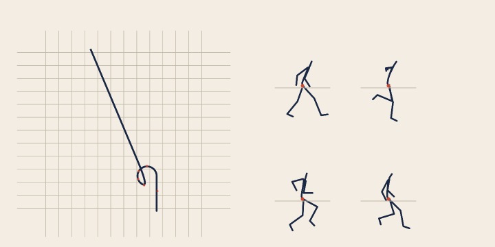

# Motion matching

A character that walks, runs, turns and stops without a state machine. Every pose of every clip is a row in a
database; every few frames the engine describes the pose it is in and the path it wants to take, finds the row that
fits best, and jumps there. Locomotion is not "enter the run state" — it is "this is the 412th frame of `walk1`".

The implementation follows [`Jacinth-19/MotionMatchingInUnity`](https://github.com/Jacinth-19/MotionMatchingInUnity),
the reference project that ports the method to Unity over LAFAN1 motion capture. It is a port, not a copy: the
reference's Unity-specific parts are replaced with what this engine has, the search is a KD-tree instead of a linear
scan, and the parts the reference leaves to Unity's animator — the pose descriptor, the cost function, the blend — are
implemented here.

The whole of LAFAN1 runs through it: **77 captures, 490 000 poses, 333 MB of BVH** load in 5.7 s, build a database in
0.7 s, and answer a match in **0.37 ms**.

## 1. What the reference does

| Stage | MotionMatchingInUnity | Ukiyo |
| --- | --- | --- |
| Motion data | LAFAN1 BVH imported into Unity `BVHAnimationClip` assets | A BVH reader that produces `MotionClip` directly; LAFAN1 files load as they are |
| Features | trajectory prediction plus a pose descriptor built by the project | 33 numbers: 24 for the trajectory, the feet and the root, 9 for the body |
| Query | player input becomes a predicted trajectory | a target velocity and heading become the same trajectory shape |
| Search | a linear scan over every frame | a KD-tree over 17 of the 33 dimensions, then a full-cost re-rank |
| Playback | pick and blend in Unity's animator | frame advance, inertialized blend of joint positions, then a retarget onto the model's humanoid rig |

The reference ships the corpus but not a solver — its runtime is Unity's animator, driven by hand-authored blend
trees. The solver here is ours, and running it over the corpus is what found most of the bugs in this document.

## 2. The feature vector

All 33 values are in the character's own frame — the root position is subtracted and the root yaw is divided out — so
the same database serves any heading and a walk that curves left is the same data as a walk that curves right.

| Index | Meaning | Index weight |
| --- | --- | --- |
| 0–7 | root position at +0.15, +0.30, +0.45, +0.60 s, as (x, z) pairs | 1.00 |
| 8–9 | facing direction at +0.60 s | 0.60 |
| 10–12 | left foot offset from the root | 0.55 |
| 13–15 | right foot offset from the root | 0.55 |
| 16–18 | left foot velocity | 0.15 |
| 19–21 | right foot velocity | 0.15 |
| 22–23 | root velocity | 0.50 |
| 24–32 | head, left hand and right hand offsets from the root | 0.45 |

The trajectory is *relative*: two frames at different points of a straight walk have the same future trajectory. That
is deliberate — the trajectory says where the player wants to go, not where the character has been — and it is why the
player compares a candidate against walking **on**, not against standing still (§4).

The pose block (24–32) is not decoration. Without it the search only knows where the character is going, so a frame
with the same velocity but the arms at the opposite end of their swing scores exactly as well as the one the body is
already in, and the blend has to travel half a metre of arm swing to fix it. It also has to be **the right nine
numbers**: the root velocity is part of the trajectory, not of the pose, and copying it from the pose source (as the
first version did) made a 1.6 m/s query ask for 1.6 m of travel *and* for the root to stand still, so the search
preferred slow frames that happened to drift forward. A run query matched a crawl.

## 3. Building the database

`MotionDatabase::build` takes any number of `MotionClip`s and samples every frame:

* the root is the clip's root joint; its yaw is unrolled across frames, so a capture that spins past 180° does not
  flip the local frame;
* feet are found by name (`LeftFoot`, `leftFoot`, …), so LAFAN1, CMU and Mixamo skeletons all work;
* velocities are central differences over ±0.1 s, clamped at the ends;
* every frame becomes a `MotionEntry` with its clip, frame number and 33 floats.

Two things are done to the clip before any of that, and both were necessary before the corpus behaved at all.

**The rest-pose lead-in is trimmed.** Every LAFAN1 file opens with the performer standing in a T-pose while the suit
calibrates — around 80 frames, nearly three seconds. It is not motion, but the database indexes every frame it is
given, so the matcher can match *into* it: a player started at frame 0 stood with its arms out while the controller
asked it to run, and the first jumps were 1.2 m wide because a T-pose and a run pose really are that far apart.
`trimRestLeadIn` detects the hold by shape rather than by file name — both hands held wider apart than any shoulder and
the whole skeleton moving less than 0.30 m/s — and drops it. The test is per frame, not drift from frame 0: the suit
calibration creeps a couple of centimetres a second, and a drift test either never triggers or trims the real
transition.

**Forward comes from the toes.** The root joint's local axes are not the character's axes. Measured across all 77
captures, the hips' local +Z points **90° away** from the toes, consistently; a yaw read off the hips is a quarter
turn from the way the performer faces. That single mistake made the character walk sideways and made every forward
query match backwards motion. The loader takes the character's forward from the toes at the rest pose and rotates every
frame's yaw by the difference — derived per file rather than hard-coded, so a skeleton with another rest orientation
still lands right.

The entries are then sorted into a KD-tree. Each node splits on the dimension with the widest spread, at the median,
and a query walks the near subtree first and prunes the far one when the split plane is already further away than the
current worst of the k best.

**The tree indexes 17 of the 33 dimensions, and that is what makes it usable.** A tree over all 33 degenerates:
measured on the corpus, a query visited most of the tree and took **21–24 ms** — slower than a brute-force scan over
the whole database (13 ms), and worse the larger k got. In 17 well-chosen dimensions the same tree answers in
**0.16–0.27 ms**, because the points are far from uniformly distributed along them and pruning works. The subset is
chosen for what separates one kind of motion from another: where the root goes and how fast, which way the body faces,
how high the head is, and where one foot is. A crawl and a run can share a trajectory; they cannot share a head
height. The full 33-dimension cost then ranks the candidates the tree returns.

```cpp
MotionClip walk;
loadMotionBvhFile("assets/motion/walk1_subject1.bvh", &walk, &error);

std::vector<MotionClip> clips{walk, run, turn};
MotionDatabase database;
database.build(std::move(clips), MotionSettings{}, &error);
```

To point it at a capture folder:

```cpp
std::vector<MotionClip> clips;
std::string note;
loadMotionBvhFolder("assets/motion/lafan1", &clips, &note);   // "loaded 77 of 77 BVH files"
```

| Corpus | Entries | Load | Build | Peak memory | Match |
| --- | --- | --- | --- | --- | --- |
| 3 captures | 21 894 | 0.27 s | 0.02 s | 24 MB | 0.08 ms |
| 77 captures | 489 942 | 5.7 s | 0.7 s | 292 MB | 0.37 ms |

Most of the memory is the pose data every frame needs at playback time: 490 000 poses × 27 joints × 12 bytes.

`MotionSettings` carries the trajectory step, the velocity window, the feature weights, the continuity price, the
switch margin and the pose weight. The defaults (trajectory 1.0, facing 0.6, feet 0.55, foot velocity 0.15, root
velocity 0.5, pose 0.45 per feature, `poseWeight` 1.0) are the ones the corpus and the tests agree on. Foot velocity
is deliberately the lightest of the motion terms: it describes what the feet are doing *now*, so a heavy weight there
means a character that is asked to stop argues with its own feet — it kept walking because the walking foot velocity
it had was cheaper than the idle pose it was being offered.

## 4. Choosing a frame

`MotionPlayer::update` advances the current frame at the clip's own rate, then every 0.16 s:

1. builds a query from the target velocity and heading, and from the pose **one match interval ahead**;
2. asks the KD-tree for 48 candidates;
3. prices each candidate with one function, `MotionDatabase::cost`: weighted feature distance + `poseWeight` × the
   mean distance between the candidate's **whole skeleton** and the predicted pose + a continuity term;
4. compares the winner with the cost of simply walking on for another match interval. A candidate that is not better
   by `switchMargin` is discarded.

Three details in that list are the difference between a system that works and one that loops in place, and each was
found by running the corpus.

**The query pose is ahead, not here.** A candidate is scored at the *start* of its trajectory, while staying is
measured at the end of the interval. Comparing both against the pose on screen makes every candidate win by half an
interval, and the winner is then the frame just left: the character plays ten frames, jumps back, plays ten, jumps
back — a 10-frame loop that looks like a stutter while the controller walks it forward. Asking for the pose at
`t + interval` puts the continuation frame exactly on the query, which is what makes "stay" and "keep going" score the
same.

**A rewind is priced like a cut.** Jumping backwards along the current clip is as visible as jumping to another one,
and must not be cheaper than a short hop forward — otherwise the cheapest move is always to return to the frame just
played.

**The switch margin always applies, including mid-blend.** It used to be skipped while a blend was still running, on
the theory that a clearly better match should be allowed to take over. But matches arrive every 0.16 s and a blend
lasts 0.20 s, so *every* match lands mid-blend, and the guard turned into "always switch to the cheapest candidate" —
which is the frame just left.

**The pose term is in the cost, not a tie-break after it.** It used to be applied only among candidates within a
tolerance of the best trajectory cost, with the reasoning that a weight would let the pose veto a genuinely better
trajectory match. The flaw is that the switch decision compares the winner with *staying*, and a term that applies to
one side of that comparison makes the decision meaningless. It is now part of one cost function used everywhere. The
corpus is what makes it necessary: with a 3-joint pose descriptor, a forward roll matches "run forward at 1.6 m/s" as
well as a run does, because a roll does travel forward at about that speed and the trajectory features do not care
that the character is horizontal. The re-rank compares all 27 joints — a few microseconds, no extra memory, because
the frames are already in the clips.

On a jump, the player snapshots the pose it was showing **and its velocity**, switches to the new clip and frame, and
*inertializes*: instead of crossing to the new pose, it subtracts a decaying offset from it. The offset's curve is the
quintic that starts at the old pose's position and velocity and ends at zero position and velocity:

```
x(s) = p + v·s − (10p + 6v)s³ + (15p + 8v)s⁴ − (6p + 3v)s⁵
```

`p` and `v` are the position and velocity differences between the outgoing and incoming poses at the instant of the
jump, and `v` is scaled by the blend time because the polynomial's variable is normalised progress, not seconds. The
blend runs for 0.20 s; root rotation is slerped with the same weight.

The difference from a crossfade is entirely at `s = 0`. A smoothstep also arrives at rest, but it *starts* at rest, so
a crossfade stops the character dead for a frame at every match — invisible in a still, obvious in motion. The quintic
matches `x'(0)` as well, so the seam is C1. `tests/motion_test.cpp` checks both ends of the curve directly, plus the
property that matters in play: the pose is still moving one frame after a match.

The offset is **root-relative**, and the root's own offset is zero. Two captures are hundreds of frames apart in their
own space, so the difference between their absolute root positions is metres — and the controller renders
`joint − root`, which turns a residual on the root into the same residual on every joint with the opposite sign: the
character slides sideways for the whole blend. What has to carry across the seam is the pose, and the pose is
root-relative.

`MotionPlayer::lastMatchOffset()` reports the largest offset the last blend had to travel. It is the number to watch:
on the synthetic clips the demo's mean is 0.067 m; across all 77 captures, where the matcher crosses between performers
of different heights and between a walk and a sprint, it is 0.56 m mean and 1.09 m worst.

## 5. The controller

`MotionController` is the runtime layer between a gamepad and the database. It owns the world transform — position and
heading — and every frame:

1. approaches the wished velocity at a fixed acceleration (7 m/s²), so the matcher never sees a step change it cannot
   find a pose for;
2. turns the body towards the facing at 7.5 rad/s by the shortest arc;
3. hands the resulting velocity and yaw to the `MotionPlayer`;
4. takes the sampled clip pose, strips the clip's own root translation **and rotation**, and re-expresses it around
   the character.

Step 4 is the part that is easy to get wrong: a turning clip already carries its own yaw, and applying the controller's
yaw on top of it spins the character twice. The controller therefore computes `q = yawQ · inverse(rootRot)` and places
every joint at `position + q · (clipJoint − clipRoot)`.

The clip's root is the hips, about a metre above its own floor, so the pose is additionally lifted by the root's height
over the clip's lowest point (`MotionClip::ground`). Without that the character is buried to the waist.

`applyTo(model)` then writes that world pose onto a humanoid rig through the directional retarget of §6.


*`tools/motion_demo.cpp`: ten seconds of input over the synthetic clips CI can build — walk, run, strafe left and
right, idle — with foot locking on (§5a). Left: the route (walk, a left-hand curve, a run leg that overshoots the
curve, then a stop) with footprints in vermilion. Right: four poses projected along each moment's own forward axis, so the stride is visible.
The route covers 17.18 m, peaks at 5.00 m/s and ends at rest; the matcher chooses 13 times and plays walk, run and
idle — the stop is a real match to the idle clip, not a frozen walk. Blend offsets average 0.067 m. The tool prints
the database's build time, peak memory, match cost, per-clip usage and blend offsets, and fails if the character does
not move, never re-matches, or does not stop.*

Run the same tool with a capture folder as the second argument and it uses the real corpus:

```sh
./build/motion_demo renders/motion-demo.png assets/motion/lafan1
```



*The same route over all 77 LAFAN1 captures: 489 942 entries, 13 matches, ten different clips played, and the path is
the same 17.18 m because the controller, not the animation, owns the transform. The blend offsets are larger — 0.56 m
mean, 1.09 m worst — because the route crosses between performers of different heights and from a walk into a sprint.
That is the retargeting gap in §8, and it is what a height-normalised pose descriptor would fix.*

## 5a. Foot locking

The matcher chooses by trajectory, so the clip it picks has its own stride — close to the wish, never equal to it.
When the character accelerates, or when a match crosses between two clips whose strides differ, the difference is
visible as a foot that keeps moving after it has touched down. The controller owns the world transform, so it can see
the foot in world space, and that is where the correction belongs.

Every frame, for each foot (found by name, as the features already find them):

1. **Contact.** The foot is in contact when it is within 6 cm of the character's ground plane and moving slower than
   0.9 m/s *in the clip's own pose*. The second condition is measured before any correction, because a foot that has
   been pinned would look stationary and the lock would never let go.
2. **Pin.** The first frame of contact remembers the foot's world position. Every later frame of that contact the
   correction is `pin − current`.
3. **Solve.** The ankle is put back on the pin by an analytic two-bone solve on hip, knee and ankle, and the foot's
   whole subtree (the toe, and anything else parented to the ankle) is carried by the same rotation *about the knee*
   — which is what keeps the shin's length exactly `|ankle − knee|`.
4. **Release.** 70 ms of lost contact unlocks the foot, and the correction fades over 90 ms instead of snapping back.

Two details stop it from reading as IK. The knee's bend direction is carried from frame to frame, so the pole never
flips on a nearly straight leg; and a lock that would need more than 32 cm of correction — the controller has outrun
the clip's stride — is dropped rather than clamped, because a hyper-extended leg reads worse than the skate it
would have hidden.

The tests measure it on a synthetic walk cycle built at 1.2 m/s and driven at 1.8 m/s, which is a 0.6 m/s mismatch
held for seven seconds:

| | Slide per contact frame | Leg length error |
| --- | --- | --- |
| No lock | 0.0209 m | — |
| Foot locking on | **0.0011 m** | < 1 mm |

`motion_test` asserts all of it: the slide falls by more than 65 %, the leg is not stretched, the character does not
lose its travel, a matched walk keeps a foot locked through every stance, and the foot still swings a full stride per
cycle. At the clip's own speed the correction is near-silent (0.0015 m per contact frame), which is the property that
matters most: a lock that moves the foot on a correct clip is a bug that only shows where nothing needed fixing.

## 6. Driving a model

`applyMotionFrame(model, clip, frame)` writes the frame into the pose arrays the rest of the engine already consumes
(`poseActive`, `poseRot`, `poseTrans`), so `updateModel` then runs IK, spring bones and the skin palette as usual.

The retarget is **direction-based**: for each joint the reader finds a humanoid node by name, computes the swing from
the model's rest bone direction to the motion's bone direction, converts that swing into the parent's space, and
multiplies it into the node's rest rotation. Bone lengths stay the model's own, so a 1.5 m rig and a 1.8 m capture
both read. It is the right retarget for locomotion and the wrong one for a hand plant: foot and hand positions are
not solved for, only directions.

## 7. Tests

`tests/motion_test.cpp` runs without a device and is built as `motion_test`; CI runs it on every push.

```sh
./build/motion_test     # 48 checks, exit code 0
./build/motion_demo renders/motion-demo.png
```

It parses a three-joint BVH (including `End Site`), rejects a malformed one, checks that a straight walk has no
lateral trajectory and that its root-velocity feature equals the clip speed, compares the KD-tree's four nearest
against a brute-force scan over forty random queries, verifies that a 1.4 m/s query never matches a 4.2 m/s run, and
plays three seconds of walking: the character must move forward and sample one position per joint.

The regression tests are the ones that matter here, because each of them is a bug that the corpus found:

| Check | The bug it holds shut |
| --- | --- |
| the T-pose hold at the head of a capture is trimmed | matching into the calibration pose; the T-pose start |
| travel is forward in the character's own frame | the 90° hips-to-toes error |
| the query's root velocity is the requested velocity | copying the pose source's root velocity |
| the pose term keeps the match in the frame the body is already in | two clips with the same trajectory and opposite phase |
| the KD-tree returns the same four neighbours as a brute-force scan | pruning that does not match the metric |
| the offset starts with the outgoing velocity, ends at rest | the inertialization curve |

## 8. Limits

* **Foot locking is a pose correction, not a motion plan.** It pins the ankle, so a stride that is far too long or too
  short still shows in the knee and in the hip height; what it removes is the skate. A proper fix at extreme
  mismatches is to bias the search by stride length, which is a feature the database does not carry yet.
* **No idle in LAFAN1.** The corpus is locomotion and action only — no standing still. Ask for 0 m/s and the best the
  matcher can do is the slowest frame it has, so the character walks in place while stopped. A production database
  adds an idle clip and the problem disappears: the synthetic demo clips include one, and the controller stops cleanly
  with them.
* **Cross-subject blends.** The corpus has five performers of different heights, and the player blends raw joint
  positions. Crossing between subjects costs a larger blend (the 0.57 m mean above); the pose term keeps it in one
  subject where it can, but a height-normalised pose descriptor would be the proper fix.
* **No tags or events.** LAFAN1 has footsteps and jumps marked in its own tooling; this reader ignores annotations.
* **The search is static.** Clips added at runtime need a rebuild (0.7 s for the full corpus, so that is cheap).
* **Directional retarget only** (§6).
* **No editor page yet.** The API is in `src/engine/motion_match.h`; the animation panel still plays clip libraries.

Those are the honest gaps, and they are the order the system would grow: a height-normalised pose descriptor first,
then annotations.
