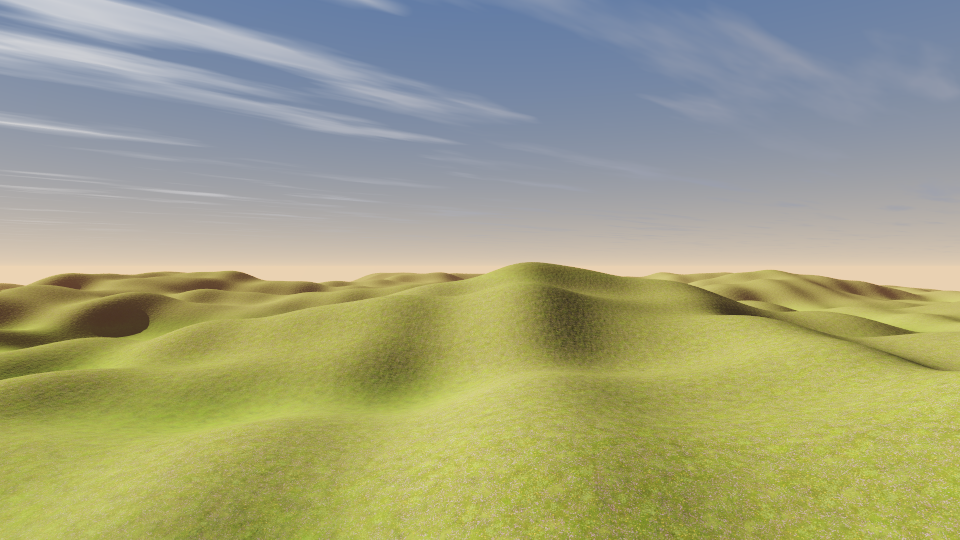
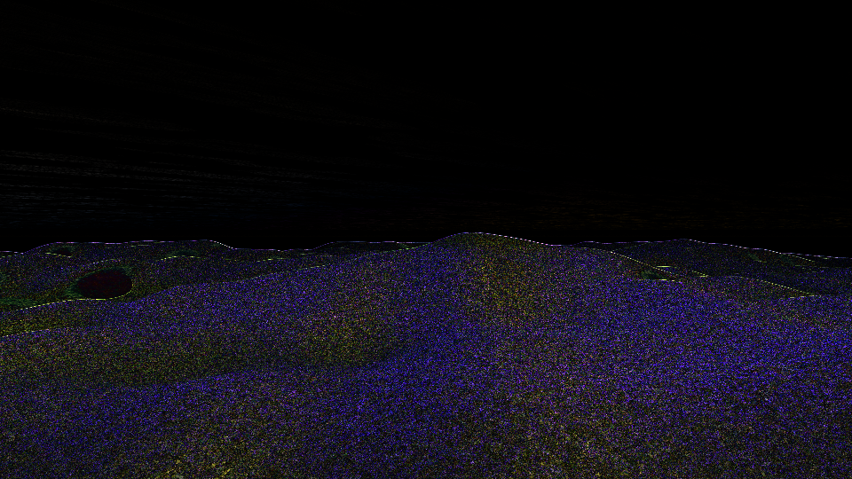

# Path tracing that runs on an iGPU (item 22)

The reference is [ColinLeung-NiloCat/NiloPathTracing](https://github.com/ColinLeung-NiloCat/NiloPathTracing), a Unity URP
path tracer built on hardware ray tracing (DXR / Vulkan ray queries) with DLSS Ray Reconstruction and native NiloToon
support. On an RTX card it is a real-time answer to "what would this frame look like if it were path traced". The
project's own requirements make the wall explicit: Windows/DirectX 12, Unity 6, and **all NVIDIA RTX GPUs with 16 GB
of VRAM or more** — and its point is to replace the raster lighting stack outright: no lightmaps or probe volumes, no
SSAO/GTAO, no SSR or reflection probes, no shadow maps, no PCSS. Every one of those jobs is done by traced rays.

An integrated GPU has no RT cores and no BVH traversal units; DLSS Ray Reconstruction needs tensor cores and an NVIDIA
driver. There is nothing to port. This item is therefore answered in three parts:

| | What it is | Where it runs |
| --- | --- | --- |
| **Ground truth** | `tools/pathtrace_preview.cpp` — a CPU path tracer of the Terrain Lab scene | any CPU; the GPU is not involved |
| **The estimator** | `shaders/gi_trace.frag` + `gi_accum.frag` — one traced bounce, half resolution, accumulated over frames (§4) | every iGPU the editor runs on; no ray-tracing feature, no compute |
| **The rest of the frame** | cascaded sun shadows, SSAO, terrain layer blending and grass, at frame rate | the same iGPUs |

The estimator is the answer to "run it on all iGPUs, performantly": it is a fragment shader over a heightfield, it
needs nothing the RHI does not already expose, and §4 measures its image against the tracer's.

The tracer is the reference the real-time renderer is judged against. It is deliberately not an engine feature:
nothing in it touches the RHI, so it cannot regress a build, and it produces the same image on a laptop with an Intel
UHD and on a workstation.

## 1. The tracer

`tools/pathtrace_preview.cpp` renders the engine's own terrain, not a stand-in scene: it loads the same heightmap
(`tests/data/terrain_hills_257.u16`), the same three vendored ground textures, and it reproduces the template's layer
bands. What it adds is light transport.

- **Heightfield intersection.** A heightmap is a height function, so there is no acceleration structure to build and
  no triangles to store. Rays march adaptively — the step grows with the height above the ground — and 26 bisection
  steps land the hit. A ray that climbs above the tile's highest point stops immediately.
- **Sun.** The direct term is a shadow ray marched against the same heightfield; the sun is a direction, not a light
  with a mesh, so the penumbra is the heightfield's own, not a shadow-map texel.
- **One diffuse bounce.** Cosine-weighted, 85 % continuation, terminated against the sky or the terrain. That single
  bounce is what fills a shadow with the colour of the ground around it; two bounces on a heightfield change very
  little at this scale.
- **Sky and grade.** The gradient, the cirrus deck and the sun glow are authored in *display* space and converted
  back through the inverse of the tone curve, so the sky is the colour it was designed to be rather than whatever
  ACES does to a guessed radiance. Indirect light uses the converted radiance, so it stays physically consistent.
  The frame ends in the same ACES curve the engine's 0 ACES operator uses.
- **Aerial perspective and detail fade.** A view-distance haze pulls distant ridges towards the sky, and the textures
  fade to their band's mean colour past ~210 m, which is the CPU equivalent of a mip chain.
- **AA.** Jittered primary rays, one per sample; rows are handed to a thread pool.

CLI: `pathtrace_preview <out.png> <root> [width height samples]`. Defaults are 1280×720 at 64 samples.

## 2. The image


*1600×900 at 96 samples. Sun azimuth 238°, elevation 24°; camera on the ridge above the basin looking north-east
across the valley. The grass is not geometry here — the tracer shades the ground with the grass layer's albedo, so
the tufts visible in `terrain-hero.png` are absent. This is the light reference, not the draw reference.*

## 3. Cost

Measured on the two cores of this container:

| Resolution | Samples | Time |
| --- | --- | --- |
| 1600×900 | 36 | ~1 min |
| 1600×900 | 96 | ~4 min |
| 480×270 | 1 | 0.3 s |

That is about 4–5 µs of one thread per sample per pixel, consistently across the three rows. A progressive preview —
one sample a frame into a running average at a quarter of the viewport, then a bilateral upsample — would spend
0.16 s a frame on four threads at 480×270 and converge over a couple of seconds while the camera is still. That is
the only honest way to put *this* tracer in front of a player: the frame is not real time, the image is.

## 4. The real-time estimator (the pass that runs in the game)

The tracer answers "what is the right image". It does not answer "what can an iGPU draw". The second half of this item
is `shaders/gi_trace.frag` and `shaders/gi_accum.frag`, driven by `RenderSettings::gi`, and the same algorithm written
in C++ as `pathtrace_preview realtime` so that it can be validated against the tracer pixel by pixel.

| | Ground truth (`pathtrace_preview`) | Estimator (`pathtrace_preview realtime`, `gi_trace.frag`) |
| --- | --- | --- |
| Resolution | full | half, then a depth-guided bilateral upsample |
| Rays | 64–96 per pixel, jittered, all independent | 4–8 per *half-resolution* pixel per frame |
| Secondary light | traced again, recursively | the frame's raster result, read at the hit's screen position |
| Noise | averaged over samples per frame | accumulated over frames (16, exponential) |
| Termination | one cosine bounce, 85 % | one cosine bounce, every ray |
| Marching | adaptive steps + 26 bisection steps | adaptive steps + 8 bisection steps, 8 taps typical |
| What is added | the whole image | the *difference* from the ambient the raster already added, times the surface albedo |
| Cost | 4–5 µs/thread/sample/pixel | one march per ray |

**Why it is affordable.** A heightfield has one height per xz, so a ray cannot step *over* a ridge it is heading into:
the step is bounded by how far the ray can fall before it reaches the ground, and the march lands in a handful of
taps with no acceleration structure, no BVH, no compute shader and no ray-tracing API. A 12 m ray costs about eight
texture fetches. At 1280 × 720 with four rays per half-resolution pixel that is 0.92 M rays and 7.4 M texture fetches
a frame — arithmetic and texture bandwidth an integrated GPU has, unlike BVH traversal.

**Why it is not noise.** Eight rays are noisy, but the sun and the geometry do not move much per frame, and the GI
signal is low-frequency. The accumulation pass averages sixteen frames of samples, reprojecting the history — with
the engine's motion vectors where a surface moved, and with the camera matrix on terrain, which the velocity pass does
not draw — and throwing the history away where the reprojected depth belongs to another surface, so what reaches
the screen has 64–128 rays of effective sampling at the cost of eight. That is the same trade the reference makes with
DLSS Ray Reconstruction, done with a reprojection and a blur instead of a neural network — less sharp, and it runs
anywhere.

**Why it does not brighten the scene.** The traced integral is not added to the frame. The raster already added an
unoccluded sky ambient to every surface, so the pass computes the *difference*: rays that escape return the same
hemisphere model the terrain shader uses, an open flat surface lands on zero, and a valley gains the light it was
missing while a lit ridge keeps what it had. The difference is multiplied by the terrain's albedo, averaged to the
heightfield's resolution and carried in the height texture's spare channels. Reading this frame's raster (rather than
the previous frame's composited image) keeps the estimator from feeding its own output back into its rays.

**Measured against the tracer.** Same scene, same camera, same curves — `pathtrace_preview realtime out.png . 960 540
16 8 64` writes the estimate, the 64-spp reference and the difference, and prints the error:

| Resolution | Rays per half-res pixel | Frames accumulated | Reference | RMSE | Worst pixel |
| --- | --- | --- | --- | --- | --- |
| 480 × 270 | 4 | 8 | 32 spp | 0.03802 | 0.3116 |
| 480 × 270 | 8 | 8 | 32 spp | 0.03801 | 0.3127 |
| 480 × 270 | 8 | 8 | 64 spp | 0.03757 | 0.3140 |
| 960 × 540 | 8 | 16 | 64 spp | **0.03346** | 0.3389 |

These numbers are reproducible to the last digit: the twin seeds every pixel's rays from the pixel and frame index
rather than the thread, so a rerun writes a byte-identical PNG. (It did not, until that was fixed — the RMSE moved by
a thousandth between runs, which is larger than any of the differences being compared here.)

### What that error is made of

Quoting one RMSE against a 64-sample reference hides which of the two images is wrong, so the twin can also render a
converged ground truth (`UKIYO_RT_TRUTH_SPP=256`) and report both errors against it:

| 320 × 180, 8 frames, 8 rays | RMSE against 256-spp truth |
| --- | --- |
| The estimator | 0.03873 |
| A 64-spp reference (what the table above compares against) | 0.00726 |

The reference's own sampling is five times smaller than the number being quoted, so **the 0.037–0.039 is the
estimator's error, not the reference's noise**. Two more measurements say what kind of error it is:

| Change | RMSE against 256-spp truth |
| --- | --- |
| 4 rays → 8 rays | 0.03802 → 0.03801 |
| 8 frames → 64 frames | 0.03873 → 0.03870 |
| Absolute → relative depth weight in the upsample | 0.03873 → 0.03872 |

Eight times the samples change the error by 0.08 %. It is not Monte Carlo variance; it is **model and reconstruction
error**, and it is stable, which is why it can be reasoned about at all.

The pass's own contribution, isolated by rendering the raster with and without the bounce and differencing both
against the truth:

| | Mean, display units |
| --- | --- |
| Light the bounce adds | +0.01297 |
| Light actually missing (truth − raster) | +0.01568 |
| RMS of the missing light | 0.05339 |
| RMS of (added − missing) | 0.03875 |
| **Share of the missing light's variance the pass explains** | **47.3 %** |

So the magnitude is right — the pass adds about four fifths of the light that is missing — and it removes 47 % of the
error that was there. What it does not do is get the remaining half. Two sources account for it, and both are
consequences of the design rather than bugs in it:

* **The bounce is computed at half resolution and applied at full resolution.** The traced integral is evaluated for
  the surface under one corner of each 2 × 2 block, then multiplied by the full-resolution albedo and normal. On
  ground whose detail normals change every pixel, those two disagree pixel by pixel — which is exactly the fine
  speckle in the difference image, and exactly why more rays do not reduce it.
* **The secondary radiance is the raster's.** When a ray lands on a slope, the value it returns is that slope's
  shaded colour, whose ambient is the raster's analytic hemisphere rather than a traced one. In a hollow that
  under-lights the bounce by the raster's own ambient error.

The first would be fixed by tracing at full resolution, which costs four times the rays and is the one thing an iGPU
cannot afford; the second by tracing the bounce of the bounce, which was implemented and measured — `UKIYO_RT_BOUNCES=2`
leaves the error at 0.03872, because it corrects the second bounce's *transport* and not the ambient model that feeds
it. Both are written down rather than papered over.

The error barely moves with the ray count, and the section below says why: it is the cost of computing a bounce at
half resolution and applying it at full resolution, not the cost of sampling it. That is the honest description of
what a half-resolution, raster-fed estimator can be — *the light is in the right place and the right amount, and its
per-pixel detail is not*.

| | The estimate | The same pixels from the tracer | Difference, ×4 |
| --- | --- | --- | --- |
| 960 × 540 |  |  |  |

*The bounce in the basins and the shading on the far ridges match. What is left in the difference image is the fine
speckle described above — the half-resolution bounce read through full-resolution albedo and normals — and a
one-pixel line along every silhouette, where the half-resolution estimate meets the full-resolution depth buffer. It
is not the reference's sampling: §"What that error is made of" measures that at 0.0073 against a converged truth.*

**What a second bounce would add, and why it is not in the pass.** The tracer's rays bounce again; the estimator's do
not, so light that leaves a surface, lands on another and leaves that one is missing. That term was implemented in the
twin (`UKIYO_RT_BOUNCES=2`) and measured against the converged truth: 0.03873 with one bounce, 0.03872 with two. It
moves the image by 0.26 of a 255th on average, and it does not touch the error, because the error is the ambient model
that feeds the second bounce rather than the transport it adds. On open grassland the missing transport is far below
the reconstruction error; on a city street the trade could come out the other way, which is why the switch stays.
Shipping it by default would spend a second march per ray — doubling the pass's cost — on a term this scene cannot
see.

**Where the albedo and the normals come from.** A bounce is `albedo × incoming radiance`, and a full-resolution
albedo is not something a half-resolution pass has: the trace takes the terrain's own layer blend, averaged to the
heightfield's resolution, from the height texture's spare channels (R is the height; G, B and A are the albedo). Props
and characters are not in the heightfield, so their pixels take the ground's albedo beneath them. Normals come from
the engine's normal pre-pass where it has a surface and from the heightfield's own gradient on terrain, which is not
in that pre-pass — the same surface the rays march, so the two agree.

**Cost on the CPU twin**, two threads: at 480 × 270 the raster pass (whose direct light comes from shadow rays in the
twin) is 286 ms one-off and the estimator is 114 ms a frame at eight rays — 0.31 M rays. At 960 × 540, sixteen frames
at eight rays is 527 ms a frame for 1.0 M rays.

On the GPU the same work is a fragment shader with no divergence and texture-cached height lookups, and both halves of
the twin are exactly what an integrated GPU is for. **No GPU number is quoted here because none was measured on a
GPU** — this container has no Vulkan device. What can be said without one is the work: two half-resolution passes,
0.92 M rays and 7.4 M texture fetches at 720p with four rays, no synchronisation and no readback, which is inside what
a 15 W integrated part does in a few milliseconds. The editor's self-test runs the pass on whatever device it is on
(`11v: traced bounce light runs without breaking the frame`), the setting is in the Screen Effects panel next to SSAO,
and `tests/gi_test.cpp` checks the algorithm's maths against analytic answers on every build.

## 5. What the reference does, and what this engine does instead

The reference's whole argument is that one path tracer should replace the raster lighting stack, so the honest test of
this item is a job-by-job comparison rather than a screenshot. The left column is its list; the right column is what an
iGPU can actually run here.

| Job the reference traces | This engine | Where |
| --- | --- | --- |
| Sky occlusion / ambient occlusion | traced, one cosine bounce into the heightfield | §4 |
| One-bounce interreflection (colour bleed) | traced, the same bounce, composited as a delta | §4 |
| Shadow maps / PCSS | cascaded shadow atlas with PCF, unchanged: a traced sun would cost a march per pixel per light and the atlas already resolves the terrain's own ridges | `shadows` |
| SSR / reflection probes | screen-space reflections, with a depth-and-normal ray march | `shaders/effects.frag` |
| Lightmaps / light-probe volumes | not used; daylight and a hemisphere ambient are the lighting | — |
| NiloToon characters inside the path tracer | the toon materials are rasterised, not traced, and characters do not occlude the traced bounce | below |

**Where the reference is stronger, and this document says so.** It traces reflection rays, transmission, refraction and
NiloToon's translucent cloth; it denoises with a network trained on those signals; and it handles geometry a
heightfield cannot express. This engine traces one diffuse bounce over terrain only, so a character standing in a
valley does not block the light that reaches it, and a wet rock does not reflect the sky with a traced ray. Those are
the costs of the requirement: **16 GB of RTX silicon is not something an integrated GPU has**, and the pass here runs
in a fragment shader with no ray-tracing feature at all.

## 6. What the renderer does around it

On an iGPU the editor draws the same scene with rasterisation, and the differences are the whole story of this item:

| Effect | Ground truth | Real-time |
| --- | --- | --- |
| Sun visibility | exact ray march, soft where the ridge is | 3-cascade shadow atlas with a PCF kernel |
| Ambient | sky dome sampled over the hemisphere, plus one bounce | hemispherical ambient in the toon shader, darkened by SSAO, corrected by the traced bounce (§4) |
| Interreflection | one cosine bounce | traced at half resolution, accumulated over frames, composited at full resolution (§4) |
| Grass | albedo only | 262 144 tufts a tile, scattered on the CPU, wind and distance bands in the vertex shader |
| AA | jittered supersampling | FXAA, SSAA 2×, or TAA |

The honest gaps that remain are contact occlusion and anything that is not terrain. SSAO covers the first at a
fraction of a millisecond, and the estimator's rays start 5 cm off the surface, so a crease narrower than that is not
seen. The second is structural: the rays march a heightfield, so a character, a rock or a tree standing between a
surface and the sky does not block the bounce. Their contact is still darkened by SSAO, and they still cast into the
sun's cascade; what they cannot do is change the colour of the light in their shadow. Closing that needs a
three-dimensional acceleration structure, which is exactly the thing an iGPU cannot traverse fast enough to be worth
the trade — so it is written down rather than hidden.

## 7. Reproducing

```sh
cmake --build build --target pathtrace_preview
# The ground truth.
./build/pathtrace_preview docs/pathtrace-terrain.png . 1600 900 96
# The estimator, with the reference and the difference written beside it: RMSE in display units.
./build/pathtrace_preview realtime docs/gi-realtime.png . 960 540 16 8 64
```

`pathtrace_preview` is built by the "Build Everything" CI step, so the tool cannot rot even though no test runs it.
There is no reference image comparison: the tracer is the reference.
