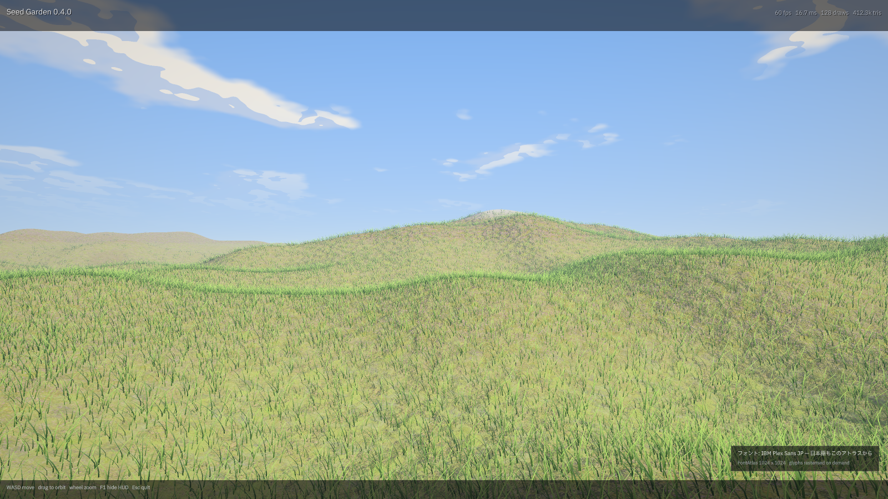

# The player, the build manifest, and text on screen

The engine could render a scene, and the editor could author one, but there was no way to *ship* anything: the editor's
Build page wrote `Build/build.json` and told the author that packaging an executable was not included, and the only
program that could open a scene was the editor with its docks, gizmos and debug overlays. There was also no text — no
font atlas, no way to draw a score, a name or a subtitle.

This is that half of the engine: a manifest the editor writes and a player reads, a scene reader that does not need Qt, a
runtime that advances the game without a window, and a HUD built on a real glyph atlas. Everything here runs without a
GPU, which is why CI can run all of it.



*1600×900. The title band, frame statistics, controls and glyph panel are drawn by `drawPlayerHud` — the function the
player calls every frame — through `tools/hud_preview.cpp`, which rasterises the same vertex list `Renderer::drawHud`
uploads to the GPU. The corner panel is the preview tool's annotation, identifying the font the glyphs came from; the
scene behind it is `docs/terrain-hero.png`, an engine render.*

## 1. The build manifest

`Build/build.json` is what the editor's **Build** page writes and `ukiyo_player` reads.

```json
{
  "format": "ukiyo-build",
  "version": 1,
  "name": "Seed Garden",
  "versionName": "0.4.0",
  "startScene": "Scenes/House.ukscene",
  "font": "assets/fonts/hud.ttf",
  "hudScale": 1.0,
  "window": { "width": 1920, "height": 1080, "fullscreen": false, "vsync": true },
  "scenes": ["Scenes/Main.ukscene", "Scenes/House.ukscene"]
}
```

`src/engine/build_manifest.{h,cpp}` parses and writes it. The rules are deliberately strict, because the writer and the
reader are different programs:

| Rule | Why |
| --- | --- |
| `format` must be `ukiyo-build` | A scene file dropped in by mistake fails here, not three layers down. |
| `version` 1..`kVersion` | A newer manifest is refused rather than half-read. |
| `scenes` must be a non-empty array | A build with no scenes cannot start. Strings and `{"path": ...}` objects are both accepted. |
| `startScene`, when set, must appear in `scenes` | A typo would otherwise boot the wrong scene silently. |
| `window` clamped to 320×240 … 7680×4320, `hudScale` to 0.25…8 | A hand-edited manifest cannot ask for a window the driver refuses. |
| Unknown fields ignored | A newer editor can add fields without breaking a shipped player. |
| `productName` accepted as `name` | The Build page wrote that field before the player existed. |

The editor's Build page now writes the whole manifest: product name, the ordered scene list with start scene, window size
and fullscreen, and the HUD font (every `.ttf`/`.otf` under `assets/fonts`, or none). Before writing it parses its own
output with `parseBuildManifest`, so the page cannot produce a file the player rejects.

## 2. Reading a scene without Qt

`src/engine/scene_runtime.{h,cpp}` is the player's `.ukscene` reader. It understands the fields the player acts on:

- the instance list (`models[]`, or a single legacy `model` string), each with `position`, `rotation`, `scale`, `yawDeg`
  (the old form, overridden by `rotation`), `lod`, `parent` by index **or** by name, and `components`;
- the instance hierarchy, repaired the way the editor repairs it: a dangling parent becomes a root, and a cycle drops the
  link that closes it, with a warning either way;
- scene lights (type, position, direction, colour, intensity, radius, cone, softness, enabled);
- the render settings the engine can apply, and the `gameCamera` block;
- prefab references, reported as a warning and left out — flattening a prefab needs the editor's prefab walker.

The reader fails only on things that make the file unusable: missing file, broken JSON, wrong `format`, `models` that is
not an array, or no instances at all. Per-instance problems are warnings, so one bad entry does not stop a game.

## 3. The runtime

`PlayerApp` (`src/player/player_app.{h,cpp}`) is the game without a window:

```
start(buildPath, projectRoot)   loadBuildManifest → firstScene → loadRuntimeScene → buildWorld
tick(dt)                        world tick → script scene switch → entity positions → world matrices → listener
hudText(draws, tris)            the strings the HUD shows
```

`buildWorld` maps components onto the systems' existing APIs — dynamic sphere/box bodies, static boxes, agents, emitters,
actions, audio (loaded from the project, positioned, looped, played), and one script. Each tick it measures the horizontal
speed of every animated instance for the locomotion state machine, feeds the script's `speed` parameter, and resolves the
instance hierarchy into world matrices that the renderer uses directly.

A script can call `ukiyo.loadScene("Scenes/X.ukscene")`. The switch is deferred to the end of the tick, the new scene is
loaded, the generation counter moves, and `main.cpp` reloads models on the change.

The player also **saves and loads** (`F5` / `F9` in a window). `src/systems/save_game.{h,cpp}` writes a versioned,
CRC-checked `UKSV` file; `PlayerApp::saveGame` stores the scene path, the play time and every instance's position and
full rotation (`rotation`, with `yaw` also written for a build that reads yaw alone; a save carrying only `yaw` still
loads, as a rotation about Y).
`loadGame` validates the checksum, the scene path and the instance names before it applies anything, so a save from
another scene or a corrupted byte leaves the running game untouched.

## 4. The binary

```
ukiyo_player --build Build/build.json --project .          windowed, Vulkan by default
ukiyo_player --backend gl                                 OpenGL 4.5
ukiyo_player --headless --shot out.png --seconds 3        render N seconds, capture, exit
ukiyo_player --selftest --project tests/fixtures/player   boot, tick 60 frames, print, exit
ukiyo_player --locale ja                                  the language the game's own text shows
```

`main.cpp` is presentation only: GLFW window, RHI device, `Renderer`, model loading (reloading when the scene generation
changes), orbit camera on the mouse, keys forwarded to the runtime as Qt key names, and the HUD drawn after the scene.
Headless mode renders into the device's offscreen target and writes a PNG, which is what a CI job or a screenshot script
uses. `--selftest` never opens a window, a device or an audio endpoint, so it runs anywhere.

## 5. Text

Text needed four things the engine did not have.

**A glyph atlas.** `src/engine/text_atlas.{h,cpp}` rasterises a TrueType font with stb_truetype into one 1024² RGBA8
page: coverage in alpha, white in RGB, glyphs packed into shelves on first use. It reports a merged dirty rectangle per
call, so the GPU upload is a sub-rectangle, not a page. The atlas refuses a glyph when it is full rather than evicting one
that is already on screen. Japanese text uses the same page: the editor's IBM Plex Sans JP covers kana and the common
kanji, and `preloadRange`/`preload` let a game warm the code points it needs.

**A canvas.** `src/engine/hud.{h,cpp}` is immediate mode: rectangles, borders, bars, text, wrapped text, centred text,
shadowed text, a dim wash, and a CPU scissor stack, all emitted as one triangle list. Coordinates are pixels, y down,
which is how a designer measures a screen.

**A renderer.** `src/engine/hud_renderer.{h,cpp}` owns one pipeline (`SetType::Hud`, alpha blend, no depth), one vertex
buffer and one atlas texture. `Renderer::drawHud` opens its own pass on the presentation target after the scene, so the
HUD never disturbs the scene's passes.

**A layout.** `src/player/hud_layout.{h,cpp}` — `drawPlayerHud` — is the shipped layout: a translucent title band, the
right-aligned statistics, a controls band, and the first warning in amber. It is used by the player, by the editor's play
overlay and by the figure above.

## 6. Tests

Eight CPU-only binaries, run on Linux and Windows; the runtime core is also compiled for arm64 and x86-64 Android.

| Test | Checks | What it pins |
| --- | --- | --- |
| `transform_test` | 83 | Euler order (ZXY), matrices, decompose, the quaternion pair, hierarchy resolution, cycle detection |
| `lights_test` | 22 | Light packing to the 64-byte GPU layout, selection scores, cone maths |
| `save_test` | 33 | `UKSV` round trip, CRC failure, exact float bits, truncation |
| `manifest_test` | 71 | The writer always parses; every refusal; old `productName` files; clamps |
| `scene_runtime_test` | 79 | Every field the player reads, legacy scenes, parents by index and name, cycles, refusals |
| `hud_test` | 60 | Glyph rasterising, atlas packing, layout, clipping, wrapping, bar fill |
| `player_test` | 74 | Boot from a manifest, start scene, hierarchy, falling bodies, HUD strings, a script's scene switch |
| `character_test` | 29 | The capsule controller: landing, walking, a wall, a step, a slope, a jump, independent characters |

On top of those, CI runs `ukiyo_player --selftest` against `tests/fixtures/player`, a real project with a manifest, two
scenes, physics bodies and a Lua script. That is the check that the things the tests prove individually also hold when the
actual binary boots a project the way a player would.

## 7. What is still missing

- **Prefabs** are reported and skipped by the runtime reader. Flattening them needs the editor's prefab walker.
- **Navigation**: an instance with an agent gets a warning, because the player does not bake a navmesh; a shipped game
  must save one next to the scene.
- **One script per scene**, the last component wins with a warning. Multiple script hosts are the next step.
- **A character, but no animation of one.** `driveCharacter` moves a capsule; `docs/CHARACTER.md` is the controller and
  what it still cannot do.
- **One sun.** Scene lights are parsed and packed, but the renderer still lights with its own sun and fill; wiring the
  scene's lights into the MToon path is tracked in `docs/AUDIT.md`.
